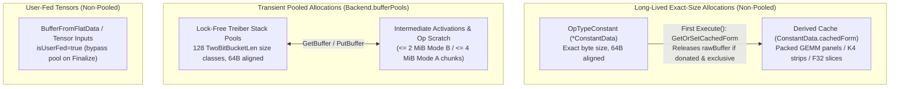
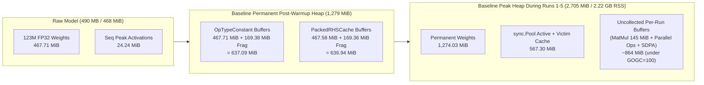

# Go Backend Memory Usage & Constant Caching

This document explains how the GoMLX `"go"` backend (`github.com/gomlx/compute/gobackend` / `internal/gobackend`) allocates, reuses, caches, and frees memory during graph compilation and execution—with a dedicated deep-dive on **constant weight caching** and the **`quantized_cache`** policy (`always` / `balanced` / `never`).

For historical context on how these memory mechanisms evolved (and the measured before/after reductions on `Timestral-123M`), see [Appendix A: Historical Case Study — `Timestral-123M` Memory Optimization (2026-11-01)](#appendix-a-historical-case-study--timestral-123m-memory-optimization-2026-11-01).

---

## 1. How the Go Backend Uses Memory

Memory in the `"go"` backend falls into four distinct categories, each with its own allocation strategy and lifetime:



### 1.1. Constants, Shared Constants, and Weight Donation (`ConstantData`)

- **Exact-size, non-pooled allocation**: Constants (`Function.Constant`, `Function.ConstantFromBuffer`) and pre-packed caches are allocated with exact byte sizes (64-byte aligned via `allocAlignedBytes`, bypassing `TwoBitBucketLen` bucketing) and never enter `Backend.bufferPools`.
- **Cross-graph sharing (`Capabilities.SharedConstants = true`)**: Unlike XLA or ONNX Runtime, the Go backend stores constant storage in `*gobackend.ConstantData` ([`constants.go`](../internal/gobackend/constants.go)) rather than tying it to a single compiled `Function`. When `graph.Exec` / `model.Exec` compiles multiple graphs (e.g., different batch sizes or sequence lengths in static mode), all compiled graphs reference the **exact same `*ConstantData`** and share any cached derived representation without duplication.
- **Inference weight donation (`Exec.DonateStore()` / `ConstantFromBuffer(buf, donate=true)`)**:
  - When a `model.Store` is donated for inference (or a buffer is passed with `donate == true`), ownership of the weight memory transfers zero-copy to `ConstantData` (`isExternalRaw = false`, `isRawBufferPinned = false`), and the `Store`'s tensor handles are finalized immediately.
  - Once all consumers of that constant have populated its derived cached form (e.g., packed GEMM panels), `GetOrSetCachedForm` atomically clears `ConstantData.rawBuffer` so Go's GC reclaims the original raw weight bytes—leaving **only one copy** in steady-state memory.
  - When a constant is **not donated** (`ConstantFromBuffer(buf, donate=false)`), `ConstantData` marks `isExternalRaw = true` and `isRawBufferPinned = true`: it can still cache and share the derived representation across graphs, while leaving the caller's raw buffer intact and never releasing it.
  - When a constant is shared between a caching consumer and an uncached consumer in the same graph (for example, tied embeddings used by both `QuantizedGather` and `FusedQuantizedDense`), `setupConstantSubgraphCaching` sets `isRawBufferPinned = true` so the raw buffer stays available alongside any cached form.

### 1.2. Transient Activation & Scratch Buffers (`Backend.bufferPools`)

- **Lock-free cross-`P` Treiber stack pools** ([`buffers.go`](../internal/gobackend/buffers.go)): Intermediate activation tensors and op scratch buffers are acquired via `Backend.GetBuffer(shape)` and returned via `Backend.PutBuffer(buf)` as soon as a node's last consumer completes (`numUsed == NumUses`).
- Sizes are rounded up via `support.TwoBitBucketLen` ($2^k$ and $1.5 \times 2^k$, mapped to 128 size buckets).
- Unlike Go's `sync.Pool`, the lock-free ABA-tagged Treiber stack does **not** strand buffers on individual `P`s across parallel barriers and is **not** wiped by `runtime.GC()` between inference calls. Pools live on `gobackend.Backend` and are released when `Backend.Finalize()` is called.
- **User-fed buffers (`isUserFed = true`)**: Buffers created by `BufferFromFlatData` bypass `bufferPools` on `Finalize()` / `PutBuffer()` so iterating over large datasets never causes unbounded pool growth.
- **In-place buffer ownership**: When an op is the last consumer of an intermediate buffer (`inputsOwned[i] == true`), elementwise and shape ops reuse the input buffer in place rather than allocating a new one.

### 1.3. Execution Modes & Peak Live Activation Memory

- **`OpsExecutionDynamic`** *(default)*:
  - When **1 execution** is live (`NumLiveExecutions <= 1`), independent graph branches run concurrently (`OpsExecutionParallel`, up to `NumExecutors = 8` goroutines). This minimizes latency but holds live activation buffers for multiple concurrent branches simultaneously.
  - When **> 1 concurrent executions** are live (e.g., serving multiple requests or embedder goroutines in parallel), each execution switches to sequential op execution (`OpsExecutionSequential`), bounding per-execution live activation memory to `FunctionExecutable.EstimatedTemporaryMemory()` and reserving CPU cores for inter-call parallelism.
- **`OpsExecutionSequential`** (`GOMLX_BACKEND="go:ops_sequential"`): Forces sequential op execution even for a single caller, minimizing peak activation memory to `EstimatedTemporaryMemory()`.

### 1.4. `Finalize()` Lifecycle & Go GC (`GOGC` / `GOMEMLIMIT`)

- `Backend.Finalize()` is goroutine-safe and idempotent (`xsync.Lifecycle`, see [`BackendsObjectsTracking.md`](BackendsObjectsTracking.md)); it waits for in-flight executions and drops all `bufferPools` references.
- `Executable.Finalize()` drops graph references, specializations, and `mainFn`, allowing unshared constants to be collected; shared constants held by a `model.Store` live until the `Store` is finalized.
- Because `bufferPools` survive GC, steady-state heap allocations per run are near zero after warm-up. Setting `GOMEMLIMIT` or tuning `GOGC` controls how aggressively Go reclaims cold-start or transient allocations (such as raw weight buffers released after first-run packing).

---

## 2. Constant Weight Caching (Standard vs. Quantized)

### 2.1. Standard Floating-Point Weights (`DotGeneral` & `FusedDense`)

For non-quantized `Float32`, `Float16`, `BFloat16`, and `Float64` weights in `DotGeneral` and `FusedDense`, pre-packing a constant weight matrix into cache-friendly GEMM panels has **`~1.0×` size** (the same dtype, just reordered into micro-tile panels).

Therefore, standard float constant caching is **always enabled**:
- On first execution, `matmul` packs the panels into `ConstantData.cachedForm` and releases `ConstantData.rawBuffer` (when donated and exclusive).
- Steady-state memory overhead is **`~0%`** (one packed copy replaces one raw copy), while eliminating weight packing on every call and across dynamic/recompiled shapes.

### 2.2. The Quantized Caching Trade-Off (`FusedQuantizedDense`)

Quantized weights (`FusedQuantizedDense`) present a fundamentally different memory/speed trade-off because the packed compute format is **larger** than the compressed storage format:

- **Mode B — Quantized Integer Matmul** (`QuantizedMatmul == true` or `XQuantization != nil` on `QuantGGML` / `QuantLinear`):
  - Sub-8-bit weights (2/3/4/5/6-bit) are unpacked into 16-column K4-interleaved `uint8` strips plus per-sub-block `float32` scale (`d'_w`) and offset (`m'_w`) vectors ([`quantizeddense_arch.go`](../internal/gobackend/quantizeddense_arch.go)).
  - Packed strip size is **`1 + 8 / subBlockSize` bytes/weight**: **`1.25 B/weight`** for 32-element sub-blocks (`Q4_0`, `Q4_K`, `Q5_K`, `Q8_0`, `QuantLinear` with `kBlock=32`) and **`1.50 B/weight`** for 16-element sub-blocks (`Q2_K`, `Q3_K`, `Q6_K`).
  - Compare to raw `Q4_K` (`0.5625 B/weight`): caching expands weights by **`2.22×`** (or **`+1.22×` net extra** after freeing donated raw weights).
- **Mode A — Weight-Only Float Matmul** (`QuantizedMatmul == false` and `XQuantization == nil`, or `QuantNF4`):
  - Weights are dequantized to `Float32` and multiplied using standard `Float32` GEMM panels (**`4.0 B/weight`**).
  - Compare to raw `Q4_K` (`0.5625 B/weight`): caching expands weights by **`7.11×`** (**`+6.11×` net extra**).
- **No-repack paths (never cached)**:
  - `QuantLinear` **Mode B1** (`XQuantization != nil`, e.g., ONNX `QLinearMatMul`) reads raw integer weight rows directly without repacking, so its weights never trigger caching.
  - Supporting tensors (`wScale`, `wZeroPoint`, `xScale`, `xZeroPoint`, `outScale`, `outZeroPoint`, `bias`) that are already in their compute dtype (`Float32`, or `Int32` for integer-matmul zero-points/biases) are read zero-copy and never trigger caching.

#### Why One-Size-Fits-All Fails (Small Models vs. Large LLMs)

| Dimension | Small / Medium L3-Resident Models (e.g., MiniLM ~22M, BGE-base ~110M) | Large LLMs Exceeding L3 Cache (e.g., 1B–70B GGUF) |
| :--- | :--- | :--- |
| **Throughput (Cached vs. Streaming)** | **Faster (+15–20% on small-$M$ concurrent calls)**: unpacked panels (`13–106 MiB`) stay hot in L3 cache and skip per-call SWAR unpacking. | **Often *slower* on $M = 1$ token decode**: weights stream from DRAM on every token; reading `1.25–1.50 B/w` cached panels instead of `0.56 B/w` `Q4_K` (+ L2-resident 2 MiB unpack) can **more than double DRAM traffic**, cutting decode tok/s up to ~2×. |
| **Memory (Single Execution)** | Modest net overhead (`+7.5 MiB` on MiniLM, `+58 MiB` on BGE-base for donated `Q4_K`). | Huge expansion: a 7B `Q4_K` model grows from `4.0 GB` $\to$ `8.75 GB` steady-state (`12.75 GB` cold-start peak before GC) in Mode B, or **`~28 GB`** in Mode A. |
| **Memory (Many Parallel Executions)** | **Caching can *save* RAM**: without caching, $P$ concurrent executions each hold a pooled scratch panel up to `2 MiB` (`12–64 MiB` across 12–32 workers, persisting in `bufferPools`). When the cached model is smaller than $P \times 2\text{ MiB}$, sharing one cached copy uses *less* RAM than $P$ scratch buffers. | Pooled streaming scratch is still only `24–64 MiB` across 12–32 workers (each layer reuses the same `2 MiB` pooled buffer), which is negligible compared to `+4.75 GB` of cached panels. |

---

### 2.3. The `quantized_cache` Policy (`always` / `balanced` / `never`)

Configured via `GOMLX_BACKEND="go:quantized_cache=<value>"` (or `compute.NewWithConfig(...)`):

| Value (and Aliases) | Policy | Behavior |
| :--- | :--- | :--- |
| **`balanced`** *(default)* | `QuantizedCacheBalanced` | Per-constant compile-time decision combining a **per-weight size cap** (`<= 4 MiB`) and a **net extra memory ratio cap** (`<= 2.0×` raw size). Detailed below. |
| **`always`** *(or `true`, `1`, or bare `quantized_cache`)* | `QuantizedCacheAlways` | Caches every eligible constant quantized weight (both Mode B K4 panels and Mode A `float32` GEMM panels) and supporting constant tensor regardless of size or expansion ratio. Donated raw buffers are freed once cached; non-donated constants are still cached and shared across graphs while keeping the caller's raw buffer intact. |
| **`never`** *(or `none`, `false`, `0`)* | `QuantizedCacheNever` | Disables quantized constant caching completely. All quantized weights and supporting tensors are unpacked/converted on the fly in bounded pooled chunks (`<= 2 MiB` Mode B, `<= 4 MiB` Mode A). |

#### How the `balanced` Strategy Works

The decision is evaluated **once per constant at graph compile time** inside `setupConstantSubgraphCaching()` ([`constants.go`](../internal/gobackend/constants.go), via `ConditionalConstantCacheNodeData`) and baked into the compiled node—there is **zero runtime decision overhead** on subsequent executions.

For each eligible constant tensor, `QuantizedCacheBalanced` enables caching if and only if **both** conditions hold:

1. **Per-tensor size cap**:

$$
\text{cachedBytes} \le 4\text{ MiB} \quad (\text{DefaultQuantizedCacheMaxWeightBytes})
$$

2. **Net extra memory ratio cap**:

$$
\text{extraBytes} \le 2.0 \times \text{rawBytes} \quad (\text{DefaultQuantizedCacheMaxExtraRatio})
$$

   where:
   - If the constant's raw backing memory **will be freed** after caching (donated / owned constant with no uncached consumers: `canReleaseRaw && !isRawBufferPinned && !isExternalRaw`):

$$
\text{extraBytes} = \max(0,\; \text{cachedBytes} - \text{rawBytes})
$$

   - If the raw backing memory **must stay alive** (non-donated `ConstantFromBuffer(..., donate=false)` or shared with an uncached op such as `QuantizedGather`):

$$
\text{extraBytes} = \text{cachedBytes}
$$

*(For `QuantLinear` and `QuantNF4` weights, `rawBytes` includes the associated constant `wScale` and `wZeroPoint` tensors that are baked into the weight panel.)*

#### Exact Per-Format Behavior Under `balanced` (for Weights `<= 4 MiB`)

| Format & Mode | Raw (`B/w`) | Cached (`B/w`) | Total Ratio (`cached/raw`) | Donated Net Extra | `balanced` (Donated) | `balanced` (Non-Donated / Pinned) |
| :--- | ---: | ---: | ---: | ---: | :---: | :---: |
| **Mode B** — `Q8_K`, `Q8_0`, `Int8`/`Uint8` (`kBlock=32`) | `1.00–1.14` | `1.25` | `1.10×–1.25×` | `+0.10×–0.25×` | **Cached** | **Cached** *(raw kept)* |
| **Mode B** — `Q5_0`, `Q5_1`, `Q5_K`, `Q6_K` | `0.69–0.82` | `1.25–1.50` | `1.67×–1.83×` | `+0.67×–0.83×` | **Cached** | **Cached** *(raw kept)* |
| **Mode B** — `Q4_1` | `0.625` | `1.25` | `2.00×` | `+1.00×` | **Cached** | **Cached** *(raw kept)* |
| **Mode B** — **`Q4_K`, `Q4_0`, `IQ4_NL`** | `0.5625` | `1.25` | `2.22×` | **`+1.22×`** | **Cached** | Skipped (`2.22× > 2.0×`) |
| **Mode B** — **`QuantLinear Int4/Uint4`** (`kBlock=32`) | `~0.625` *(w+scale)* | `1.25` | `~2.00×` | **`+1.00×`** | **Cached** | **Cached** *(~2.0×)* |
| **Mode B** — `Q3_K` | `0.43` | `1.50` | `3.49×` | `+2.49×` | Skipped | Skipped |
| **Mode B** — `Q2_K`, `Int2`/`Uint2` | `0.25–0.33` | `1.25–1.50` | `4.57×–5.00×` | `+3.57×–4.00×` | Skipped | Skipped |
| **Mode A** (`float32` panels) — all quantized formats | `0.33–1.06` | `4.00` | `3.76×–12.2×` | `+2.76×–11.2×` | Skipped | Skipped |
| **Any weight with `cachedBytes > 4 MiB`** (e.g., 1B–70B LLM layers) | any | `> 4 MiB` | any | any | Skipped | Skipped |

#### Standardized Handling of `QuantLinear`, Mode A, and Supporting Constants

All `FusedQuantizedDense` variants share the same two-pass `ConstantData` caching pipeline ([`constants.go`](../internal/gobackend/constants.go), [`quantizeddense.go`](../internal/gobackend/fusedops/quantizeddense.go)):

| Constant Input | Cached Format | Uses Shared `ConstantData`? | Releases Donated Raw? | Shared Across Graphs? |
| :--- | :--- | :---: | :---: | :---: |
| **`QuantGGML` Mode B weight** | K4 `uint8` + scale strips | Yes | Yes | Yes |
| **`QuantLinear` Mode B2 weight** | K4 `uint8` + scale strips | Yes | Yes | Yes |
| **Mode A weight** (`QuantGGML` / `QuantLinear` / `QuantNF4`, under `always`) | Packed `Float32` GEMM panels | Yes | Yes | Yes |
| **`wScale` / `wZeroPoint`** *(when weight IS cached)* | Baked directly into weight panel (`0 B` extra) | Yes | Yes *(released after weight packs)* | Yes |
| **`wScale` / `wZeroPoint` / `xScale` / `xZeroPoint` / `outScale` / `outZeroPoint` / `bias`** *(standalone, when conversion is needed, e.g. `Float16`/`BFloat16` $\to$ `Float32`)* | Exact-sized `[]float32` or `[]int32` | Yes | Yes | Yes |
| **`QuantLinear` Mode B1 weight** or **already-`Float32`/`Int32` supporting tensors** | None (no repack/conversion needed) | — | Raw kept | — |

---

## 3. Practical Memory-Tuning Recipes

| Goal | Recommendation |
| :--- | :--- |
| **General inference (recommended default)** | Call `exec.DonateStore()` so weights are shared constants whose raw copies are freed upon packing, and keep default `GOMLX_BACKEND=go` (`quantized_cache=balanced`). |
| **Strict minimum RAM (e.g. edge/embedded, 1-at-a-time execution)** | Use `exec.DonateStore()` + `GOMLX_BACKEND="go:ops_sequential,quantized_cache=never"`. Optionally set `GOMEMLIMIT` / `GOGC=20–50`. |
| **Maximum throughput on large-weight batched inference (RAM plentiful)** | Use `exec.DonateStore()` + `GOMLX_BACKEND="go:quantized_cache=always"`. |
| **High-concurrency small/medium quantized embedders** | Default `GOMLX_BACKEND=go` (`balanced`) already caches all weights `<= 4 MiB` and shares one packed copy across all goroutines. |
| **Reclaiming memory when done with a model** | Call `exec.Finalize()` and `store.Finalize()`; call `backend.Finalize()` to release `Backend.bufferPools`. |

---

# Appendix A: Historical Case Study — `Timestral-123M` Memory Optimization (2026-11-01)

> *The section below preserves the original memory profile, root-cause investigation, architectural design notes, and measured before/after results on `mistralai/Timestral-123M` that motivated the Go backend's exact-sized `ConstantData`, `SharedConstants`, `Exec.DonateStore()`, lock-free `bufferPools`, and raw-buffer release architecture.*

**Date**: 2026-11-01  
**Reference Workload**: `mistralai/Timestral-123M` (`context=12096`, `horizon=864`, `batch=2`, `quantiles=21`, `GOMAXPROCS=32`, `GOEXPERIMENT=simd` / AVX-512)  
**Command**:
```bash
cd ../go-huggingface
GOEXPERIMENT=simd go run ./examples/timestral/ -model mistralai/Timestral-123M -obs gomlx-AVX512
```

---

## A.1. Executive Summary & Answers to Key Questions (Baseline State)

For `Timestral-123M`, the raw FP32 weights occupy **`467.71 MiB` (`490.43 MB`)**, and the Go backend's static analyzer (`FunctionExecutable.EstimatedTemporaryMemory()`) shows that sequential execution of the 4,117-node computation graph requires only **`24.24 MiB` (`25.42 MB`)** of peak live intermediate activation buffers. Thus, the **theoretical minimum memory footprint** for inference is **`~492 MiB` (`0.52 GB`)**.

In practice, the baseline benchmark's peak resident set size (**Max RSS**) reached **`1.25 GB`** during `load + compile`, **`1.54 GB`** during `warm-up`, and **`2.22 GB`** (`2,705.3 MiB` Go `HeapAlloc`) by `run 5` — roughly **4.3× the theoretical minimum**.

### Direct Answers to Questions

1. **Are there any memory leaks (e.g., missing `Tensor.Finalize()` calls in the benchmark)?**
   - **In the benchmark (`examples/timestral/main.go`)**: **No.** The benchmark properly calls `store.Finalize()` after compilation and `x.FinalizeAll()` / `y.FinalizeAll()` after every run. When `exec.Finalize()` is called followed by two GC cycles and `debug.FreeOSMemory()`, `HeapAlloc` drops from `2,705.3 MiB` back down to **`1.3 MiB`** (`VmRSS: 31.7 MiB`).
   - **Inside `gobackend` & `models/timestral` (prior to fixes)**: **Yes — there was significant permanent weight duplication and two internal allocation bugs**:
     - **Permanent 2× Weight Duplication (`+636.94 MiB`)**: On the first inference pass (`warm-up`), `DotGeneral` and `FusedDense` pre-packed constant RHS weight matrices into `PackedRHSCache` (`636.94 MiB`), but **never released the original `OpTypeConstant` buffers (`637.09 MiB`)**, even though **100% of the weight constant nodes had `NumUses == 1`** and were never read again once packed.
     - **Permanent 3× Weight Duplication in `timestral.Forecaster` (`+1,274.0 MiB`)**: Unlike `examples/timestral/main.go` (which called `store.Finalize()` manually), `timestral.NewForecaster` kept `f.store` alive (`637.1 MiB`) alongside `OpTypeConstant` (`637.1 MiB`) and `PackedRHSCache` (`636.9 MiB`), holding **three full copies of the weights (`1,911.1 MiB` = `2.00 GB`)** permanently in heap memory.
     - **SDPA Unpooled Allocations & Buffer Pool Leak (`internal/gobackend/fusedops/sdpa.go`)**:
       1. `sdpaMultiHeadGeneric` allocated `workerScores := make([]T, scratchSize)` directly on the Go heap (`make`, bypassing `backend.GetBuffer`) on every call (`19.3 MiB` of garbage per inference pass).
       2. In `execFusedScaledDotProductAttention`, when `axesLayout == AttentionAxesLayoutBSHD` and `mask` or `bias` was rank 4, `transposeBuffer` allocated a new buffer via `backend.GetBuffer(outShape)` and overwrote the local `mask`/`bias` variable **without ever calling `backend.PutBuffer`** before returning.

2. **Are memory pool objects returned when `model.Exec` is finalized?**
   - **Not immediately, and `Backend.bufferPools` is not tied to `model.Exec`**:
     - `Backend.bufferPools` lives on `gobackend.Backend`, not on `Executable` or `model.Exec`. Calling `model.Exec.Finalize()` does **not** clear `Backend.bufferPools` (only `backend.Finalize()` releases it).
     - Prior to replacing `sync.Pool` with the lock-free Treiber stack, pooled buffers were **only reclaimed by Go's garbage collector across two full GC cycles** (the first GC moved active pool entries into `sync.Pool`'s `victim` cache; only the second GC freed them — the profile measured **`567.3 MiB`** sitting in the `victim` cache after 1× GC).
     - **Incomplete `Finalize()` bugs (subsequently fixed)**:
       - `gobackend.Executable.Finalize()` cleared `e.builder` and `e.specializations` but forgot to set `e.mainFn = nil`.
       - `gobackend.Builder.Finalize()` cleared `b.MainFn.Nodes = nil`, but did not clear `b.Functions` (closures) or `node.Data`.

3. **What was the peak memory usage during inference (and why)?**
   - **Peak Go Heap (`HeapAlloc`)**: **`2,705.3 MiB` (`2.84 GB`)** (`HeapSys`: `2,718.4 MiB`).
   - **Peak OS Resident Memory (`Max RSS`)**: **`2.22 GB` (`2,117 MiB` `VmHWM`)**.
   - **Why it was 4.3× larger than the 492 MiB model size**:
     1. **`TwoBitBucketLen` internal fragmentation (`+36.2%`)** inflated the `467.71 MiB` weights to **`637.09 MiB`** (`+169.38 MiB` wasted).
     2. **`PackedRHSCache` duplicated all constant weights** into a second `TwoBitBucketLen`-rounded buffer of **`636.94 MiB`** (`+169.36 MiB` wasted), bringing **permanent post-warmup weight memory to `1,274.03 MiB` (`1.34 GB`)** — **2.72× the raw weight size**.
     3. **`sync.Pool` per-`P` misses (`GOMAXPROCS=32`) + `victim` cache + `GOGC=100`**: During parallel execution across 32 threads, goroutines frequently missed local `P` pools and allocated `370–510 MiB` of new temporary buffers per run. Because permanent live memory was already `1,279 MiB` and `sync.Pool` held another `567 MiB` in its victim cache (`1,769 MiB` marked at `gc 13`), Go's `GOGC=100` set the next GC trigger to **`~3,538 MiB`**, allowing uncollected temporary buffers to pile up to **`2,705.3 MiB` (`2.22 GB` RSS)** across runs 2–5 without triggering a GC.

4. **Immediate runtime workarounds measured at the time**:
   - Setting `GOMEMLIMIT=1350MiB` capped Max RSS at **`1.28 GB`** across all runs (down from `2.22 GB`), though it increased inference latency (`0.165s` $\to$ `0.342s`) because Go's GC repeatedly flushed `sync.Pool`.
   - Setting `GOGC=20` reduced Max RSS to **`1.89 GB`** with minimal latency impact (`0.165s` $\to$ `0.177s`).

---

## A.2. Detailed Baseline Memory Profile of `Timestral-123M`

### A.2.1. Stage-by-Stage Memory Timeline

The table below shows exact measurements from `runtime.ReadMemStats`, `/proc/self/status` (`VmRSS`, `VmHWM`), and `getrusage(RUSAGE_SELF)` (`Max RSS` in decimal GB, matching `examples/timestral/main.go`) on `mistralai/Timestral-123M` (`batch=2, context=12096, horizon=864, GOMAXPROCS=32`):

| Stage | `HeapAlloc` (MiB) | `HeapInuse` (MiB) | `HeapSys` (MiB) | Cumulative `TotalAlloc` (MiB) | Current `VmRSS` (MiB) | Peak `VmHWM` (MiB) | Reported `Max RSS` (GB) |
| :--- | ---: | ---: | ---: | ---: | ---: | ---: | ---: |
| **0. Initial** | 0.8 | 1.3 | 7.7 | 0.8 | 13.6 | 13.6 | 0.01 GB |
| **1a. After `LoadStore` (pre-GC)** | 1,170.2 | 1,176.2 | 1,190.6 | 1,365.1 | 941.8 | 1,107.1 | 1.16 GB |
| **1b. After `LoadStore` (post-GC)** | 693.2 | 698.6 | 1,190.6 | 1,365.1 | 942.0 | 1,107.1 | 1.16 GB |
| **2. After `exec.Compile` (before `store.Finalize`)** | **1,335.2** | **1,338.7** | **1,350.6** | 2,007.2 | **1,177.4** | **1,177.4** | **1.24 GB** |
| **3. After `store.Finalize()` + `FreeOSMemory()`** | **642.0** | **644.8** | 1,350.6 | 2,007.2 | **622.9** | 1,170.5 | 1.24 GB |
| **4.0. After `warm-up` (`Run 0`, `255 ms`, pre-GC)** | **1,974.6** | **1,979.5** | **1,986.2** | 3,413.0 | 1,537.6 | 1,537.6 | **1.54 GB** |
| **4.1. After `Run 1` (`183 ms`, pre-GC)** | 2,054.9 | 2,060.0 | 2,222.3 | 3,926.2 | 1,769.4 | 1,769.4 | **1.71 GB** |
| **4.2. After `Run 2` (`182 ms`, pre-GC)** | 2,426.9 | 2,431.7 | 2,442.3 | 4,298.2 | 2,004.0 | 2,004.0 | **2.05 GB** |
| **4.3. After `Run 3` (`167 ms`, pre-GC)** | **2,705.3** | **2,710.2** | **2,718.4** | 4,576.6 | **2,045.1** | **2,045.1** | **2.14–2.22 GB** |
| **5a. After `1× runtime.GC()` (victim cache alive)** | **1,846.3** | **1,850.4** | 2,718.3 | 4,576.6 | 2,045.7 | 2,045.7 | 2.15 GB |
| **5b. After `2× runtime.GC()` + `FreeOSMemory()`** | **1,279.0** | **1,282.5** | 2,718.3 | 4,576.6 | **1,149.7** | 2,037.7 | 2.15 GB |
| **6a. After `exec.Finalize()` + `1× GC`** | **1.3** | 3.3 | 2,718.3 | 4,577.9 | 1,150.4 | 2,037.7 | 2.15 GB |
| **6b. After `exec.Finalize()` + `2× GC` + `FreeOSMemory()`** | **1.3** | 3.2 | 2,718.3 | 4,578.0 | **31.7** | 2,037.7 | 2.15 GB |
| **7. After `backend.Finalize()` + `2× GC`** | **1.3** | 3.1 | 2,718.3 | 4,579.3 | **31.6** | 2,037.7 | 2.15 GB |

### A.2.2. Compiled Graph & Static Buffer Breakdown (`Timestral-123M`)

| Metric | Value | Notes |
| :--- | ---: | :--- |
| **Active Graph Nodes in Schedule** | `4,117` | Out of `4,118` total nodes |
| **`EstimatedTemporaryMemory()` (Sequential)** | **`24.24 MiB`** (`25.42 MB`) | Peak live intermediate activation memory in topological order |
| **`OpTypeConstant` Nodes** | `204` | `182` weight tensors (`NumUses == 1`), `22` small/scalar constants (`NumUses > 1`) |
| **`OpTypeConstant` Exact Byte Size** | **`467.71 MiB`** (`490.43 MB`) | Matches `model.safetensors` size on disk |
| **`OpTypeConstant` Allocated Size (`TwoBitBucketLen`)** | **`637.09 MiB`** (`668.04 MB`) | **`+169.38 MiB` (`+36.2%`) internal fragmentation** |
| **`OpTypeConstant` Bytes with `NumUses == 1`** | **`637.09 MiB`** (`100.0%`) | Every large weight constant had only 1 consumer node |
| **`DotGeneral` + `FusedDense` Nodes** | `121` | All constant-weight matmuls / dense layers |
| **`PackedRHSCache` Exact Panel Size** | **`467.58 MiB`** (`490.29 MB`) | Populated lazily on `Run 0` (`warm-up`) |
| **`PackedRHSCache` Allocated Size (`TwoBitBucketLen`)** | **`636.94 MiB`** (`667.88 MB`) | **`+169.36 MiB` (`+36.2%`) internal fragmentation** |
| **Total Permanent Weight Memory After Warm-up (Baseline)** | **`1,274.03 MiB`** (`1.34 GB`) | `637.09 MiB` (`Constant`) + `636.94 MiB` (`PackedRHSCache`) = **2.72× raw weights** |



### A.2.3. `TwoBitBucketLen` Fragmentation Breakdown on `Timestral-123M` Weights

In `Timestral-123M` (`d_model=640`, `mlp_hidden_dim=1712`, `20` layers), weight dimensions sat just above `TwoBitBucketLen` boundaries before exact-size static allocations were introduced:

| Weight Tensor | Count | Exact Shape | Exact Size | `TwoBitBucketLen` Size | Waste per Tensor | Total Waste (1 Copy) | Total Waste (`Constant` + `PackedRHSCache`) |
| :--- | ---: | :--- | ---: | ---: | ---: | ---: | ---: |
| `FusedSwiGLU.w12` | 20 | `[640, 3424]` | `8.36 MiB` | `12.00 MiB` | `+3.64 MiB` (+43.5%) | `72.81 MiB` | **`145.62 MiB`** |
| `FusedSwiGLU.w3` | 20 | `[1712, 640]` | `4.18 MiB` | `6.00 MiB` | `+1.82 MiB` (+43.5%) | `36.41 MiB` | **`72.81 MiB`** |
| `Attention.wQKV` | 25 | `[640, 1920]` | `4.69 MiB` | `6.00 MiB` | `+1.31 MiB` (+28.0%) | `32.81 MiB` | **`65.63 MiB`** |
| `Attention.wO` + `wGate` | 50 | `[640, 640]` | `1.56 MiB` | `2.00 MiB` | `+0.44 MiB` (+28.0%) | `21.88 MiB` | **`43.75 MiB`** |
| Other weights (`QuantileHead`, `PatchRep`, etc.) | 89 | Various | `15.72 MiB` | `21.19 MiB` | — | `5.47 MiB` | **`10.93 MiB`** |
| **Total** | **204** | — | **`467.71 MiB`** | **`637.09 MiB`** | **+36.2%** | **`169.38 MiB`** | **`338.74 MiB`** |

### A.2.4. Summary of Fixes Implemented from This Analysis

| # | Fix | Memory Saved on `Timestral-123M` | Speed Impact |
| :-: | :--- | ---: | :--- |
| **1** | Release single-use `ConstantData.rawBuffer` once `PackedRHSCache` / `PackedLHSCache` is populated | **`-637.09 MiB`** (`-668 MB`) | None (0%) |
| **2** | Allocate exact byte sizes (bypass `TwoBitBucketLen`) for static constants and packed caches | **`-169.38 MiB`** (or `-338.74 MiB` before Fix 1) | None (0%) |
| **3** | Eliminate per-worker `4 MiB` `accumOutput` in `large` MatMul (direct interior writes + 1 KiB edge tile) | **`-128.00 MiB`** peak workspace | Faster |
| **4** | Replace `sync.Pool` in `Backend.bufferPools` with lock-free cross-`P` Treiber stack | **`-567.30 MiB`** victim cache + `-400 MiB/run` pool misses | Faster |
| **5** | Pool `workerScores` in `sdpa.go` and `PutBuffer` transposed rank-4 `BSHD` masks/biases | **`-19.30 MiB/run`** heap allocs | Faster |
| **6** | Fix `Executable.Finalize()` & `Builder.Finalize()` to release `mainFn`, sub-functions, and node data | Deterministic cleanup on `Finalize()` | None |
| **7** | Implement `Capabilities.SharedConstants` + `Exec.DonateStore()` so weights are donated once and shared across compiled graphs | **`-637.09 MiB`** during `Compile()` and in `Forecaster` | Faster compile |

### A.2.5. Measured Results After Implementation (`mistralai/Timestral-123M`, AVX-512)

Running `GOEXPERIMENT=simd go run ./examples/timestral/ -model mistralai/Timestral-123M -obs gomlx-AVX512` before and after implementing exact-sized non-pooled constants/caches, automatic `ConstantData.rawBuffer` release upon packing, cross-graph `SharedConstants` reuse, and `exec.DonateStore()`:

| Phase | Before (Baseline) | After Implementation | Delta |
| :--- | ---: | ---: | ---: |
| **Load + Compile Max RSS** | `1.36 GB` | **`1.19 GB`** | **`-0.17 GB`** |
| **Warm-up (Run 0) Max RSS** | `2.36 GB` | **`1.30 GB`** | **`-1.06 GB` (`-45%`)** |
| **Steady-State Run 1 Max RSS** | `2.54 GB` | **`1.45 GB`** | **`-1.09 GB` (`-43%`)** |
| **Best Inference Wall Time** | `0.214s` | **`0.201s`** | **Faster** |
