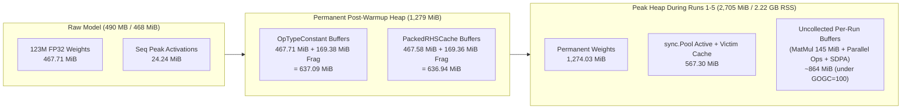
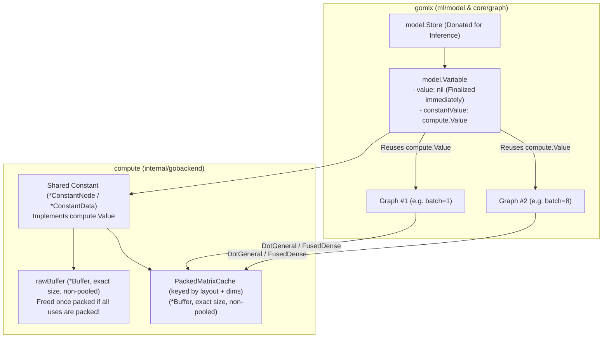

# Go Backend Memory Usage Analysis & Optimization Proposals

**Date**: 2026-11-01  
**Reference Workload**: `mistralai/Timestral-123M` (`context=12096`, `horizon=864`, `batch=2`, `quantiles=21`, `GOMAXPROCS=32`, `GOEXPERIMENT=simd` / AVX-512)  
**Command**:
```bash
cd ../go-huggingface
GOEXPERIMENT=simd go run ./examples/timestral/ -model mistralai/Timestral-123M -obs gomlx-AVX512
```

---

## 1. Executive Summary & Answers to Key Questions

For `Timestral-123M`, the raw FP32 weights occupy **`467.71 MiB` (`490.43 MB`)**, and the Go backend's static analyzer (`FunctionExecutable.EstimatedTemporaryMemory()`) shows that sequential execution of the 4,117-node computation graph requires only **`24.24 MiB` (`25.42 MB`)** of peak live intermediate activation buffers. Thus, the **theoretical minimum memory footprint** for inference is **`~492 MiB` (`0.52 GB`)**.

In practice, the benchmark's peak resident set size (**Max RSS**) reaches **`1.25 GB`** during `load + compile`, **`1.54 GB`** during `warm-up`, and **`2.22 GB`** (`2,705.3 MiB` Go `HeapAlloc`) by `run 5` — roughly **4.3× the theoretical minimum**.

### Direct Answers to Questions

1. **Are there any memory leaks (e.g., missing `Tensor.Finalize()` calls in the benchmark)?**
   - **In the benchmark (`examples/timestral/main.go`)**: **No.** The benchmark properly calls `store.Finalize()` after compilation and `x.FinalizeAll()` / `y.FinalizeAll()` after every run. When `exec.Finalize()` is called followed by two GC cycles and `debug.FreeOSMemory()`, `HeapAlloc` drops from `2,705.3 MiB` back down to **`1.3 MiB`** (`VmRSS: 31.7 MiB`).
   - **Inside `gobackend` & `models/timestral`**: **Yes — there is significant permanent weight duplication and two internal allocation bugs**:
     - **Permanent 2× Weight Duplication (`+636.94 MiB`)**: On the first inference pass (`warm-up`), `DotGeneral` and `FusedDense` pre-pack constant RHS weight matrices into `PackedRHSCache` (`636.94 MiB`), but **never release the original `OpTypeConstant` buffers (`637.09 MiB`)**, even though **100% of the weight constant nodes have `NumUses == 1`** and are never read again once packed.
     - **Permanent 3× Weight Duplication in `timestral.Forecaster` (`+1,274.0 MiB`)**: Unlike `examples/timestral/main.go` (which calls `store.Finalize()` manually), `timestral.NewForecaster` keeps `f.store` alive (`637.1 MiB`) alongside `OpTypeConstant` (`637.1 MiB`) and `PackedRHSCache` (`636.9 MiB`), holding **three full copies of the weights (`1,911.1 MiB` = `2.00 GB`)** permanently in heap memory.
     - **SDPA Unpooled Allocations & Buffer Pool Leak (`internal/gobackend/fusedops/sdpa.go`)**:
       1. `sdpaMultiHeadGeneric` ([`sdpa.go`](../internal/gobackend/fusedops/sdpa.go#L843)) allocates `workerScores := make([]T, scratchSize)` directly on the Go heap (`make`, bypassing `backend.GetBuffer`) on every call (`19.3 MiB` of garbage per inference pass).
       2. In `execFusedScaledDotProductAttention` ([`sdpa.go`](../internal/gobackend/fusedops/sdpa.go#L419-L434)), when `axesLayout == AttentionAxesLayoutBSHD` and `mask` or `bias` is rank 4, `transposeBuffer` allocates a new buffer via `backend.GetBuffer(outShape)` and overwrites the local `mask`/`bias` variable **without ever calling `backend.PutBuffer`** before returning.

2. **Are memory pool objects returned when `model.Exec` is finalized?**
   - **Not immediately, and `Backend.bufferPools` is not tied to `model.Exec`**:
     - `Backend.bufferPools` (`sync.Map` of `*sync.Pool`) lives on `gobackend.Backend`, not on `Executable` or `model.Exec`. Calling `model.Exec.Finalize()` does **not** clear `Backend.bufferPools` (only `backend.Finalize()` calls `b.bufferPools.Clear()`).
     - Because `Backend.bufferPools` and `FunctionExecutable.ExecutionBuffersPool` use Go's `sync.Pool`, pooled buffers are **only reclaimed by Go's garbage collector across two full GC cycles** (the first GC moves active pool entries into `sync.Pool`'s `victim` cache; only the second GC frees them — our profile measured **`567.3 MiB`** sitting in the `victim` cache after 1× GC).
     - **Incomplete `Finalize()` bugs**:
       - `gobackend.Executable.Finalize()` ([`exec.go`](../internal/gobackend/exec.go#L46-L50)) clears `e.builder` and `e.specializations` but **forgets to set `e.mainFn = nil`**. If a caller retains a reference to the `compute.Executable` interface after calling `Finalize()`, `e.mainFn.OutputNodes` keeps the entire graph of `*Node`s, all `OpTypeConstant` buffers (`637 MiB`), and all `PackedRHSCache` buffers (`637 MiB`) alive.
       - `gobackend.Builder.Finalize()` ([`builder.go`](../internal/gobackend/builder.go#L148-L155)) clears `b.MainFn.Nodes = nil`, but does not clear `b.Functions` (closures) and does not clear `node.Data` (`*Buffer` / `*dot.NodeData`).

3. **What is the peak memory usage during inference (and why)?**
   - **Peak Go Heap (`HeapAlloc`)**: **`2,705.3 MiB` (`2.84 GB`)** (`HeapSys`: `2,718.4 MiB`).
   - **Peak OS Resident Memory (`Max RSS`)**: **`2.22 GB` (`2,117 MiB` `VmHWM`)**.
   - **Why it is 4.3× larger than the 492 MiB model size**:
     1. **`TwoBitBucketLen` internal fragmentation (`+36.2%`)** inflates the `467.71 MiB` weights to **`637.09 MiB`** (`+169.38 MiB` wasted).
     2. **`PackedRHSCache` duplicates all constant weights** into a second `TwoBitBucketLen`-rounded buffer of **`636.94 MiB`** (`+169.36 MiB` wasted), bringing **permanent post-warmup weight memory to `1,274.03 MiB` (`1.34 GB`)** — **2.72× the raw weight size**.
     3. **`sync.Pool` per-`P` misses (`GOMAXPROCS=32`) + `victim` cache + `GOGC=100`**: During parallel execution across 32 threads, goroutines frequently miss local `P` pools and allocate `370–510 MiB` of new temporary buffers per run. Because permanent live memory is already `1,279 MiB` and `sync.Pool` holds another `567 MiB` in its victim cache (`1,769 MiB` marked at `gc 13`), Go's `GOGC=100` sets the next GC trigger to **`~3,538 MiB`**, allowing uncollected temporary buffers to pile up to **`2,705.3 MiB` (`2.22 GB` RSS)** across runs 2–5 without triggering a GC.

4. **What option(s) can we use or add to run with minimal memory usage?**
   - **Available immediately (no code changes)**:
     - Setting `GOMEMLIMIT=1350MiB` caps Max RSS at **`1.28 GB`** across all runs (down from `2.22 GB`), though it increases inference latency (`0.165s` $\to$ `0.342s`) because Go's GC repeatedly flushes `sync.Pool`.
     - Setting `GOGC=20` reduces Max RSS to **`1.89 GB`** with minimal latency impact (`0.165s` $\to$ `0.177s`).
   - **Recommended Go Backend Fixes (Always-On, Zero Latency Penalty)**:
     - Freeing single-use `OpTypeConstant` buffers once `PackedRHSCache` is populated (**`-637.09 MiB`**), using exact allocation sizes instead of `TwoBitBucketLen` for static constants and packed weight caches (**`-338.74 MiB`**), and replacing `sync.Pool` in `Backend.bufferPools` with a bounded cross-`P` free-list (**`-567.3 MiB` victim cache & zero `GOMEMLIMIT` thrashing**) will reduce default Max RSS from **`2.22 GB` to `~0.65–0.75 GB`** while **improving** speed.
   - **Proposed `"go:low_memory"` Backend Option**:
     - Adding a `low_memory` flag to the Go backend config (`compute.NewWithConfig("go:low_memory")`) that forces `OpsExecutionSequential` (`24.24 MiB` peak activation memory), frees raw constants upon packing (or disables `PackedRHSCache` when weights have multiple uses), uses exact-size allocations, and avoids the `4 MiB/worker` (`145 MiB` total) matmul `accumOutput` buffer will bring total memory usage down to **`~0.55 GB` (`~525 MiB`)**.

---

## 2. Detailed Memory Profile of `Timestral-123M`

### 2.1. Stage-by-Stage Memory Timeline

The table below shows exact measurements from `runtime.ReadMemStats`, `/proc/self/status` (`VmRSS`, `VmHWM`), and `getrusage(RUSAGE_SELF)` (`Max RSS` in decimal GB, matching `examples/timestral/main.go`) on `mistralai/Timestral-123M` (`batch=2, context=12096, horizon=864, GOMAXPROCS=32`):

| Stage | `HeapAlloc` (MiB) | `HeapInuse` (MiB) | `HeapSys` (MiB) | Cumulative `TotalAlloc` (MiB) | Current `VmRSS` (MiB) | Peak `VmHWM` (MiB) | Reported `Max RSS` (GB) |
| :--- | ---: | ---: | ---: | ---: | ---: | ---: | ---: |
| **0. Initial** | 0.8 | 1.3 | 7.7 | 0.8 | 13.6 | 13.6 | 0.01 GB |
| **1a. After `LoadStore` (pre-GC)** | 1,170.2 | 1,176.2 | 1,190.6 | 1,365.1 | 941.8 | 1,107.1 | 1.16 GB |
| **1b. After `LoadStore` (post-GC)** | 693.2 | 698.6 | 1,190.6 | 1,365.1 | 942.0 | 1,107.1 | 1.16 GB |
| **2. After `exec.Compile` (before `store.Finalize`)** | **1,335.2** | **1,338.7** | 1,350.6 | 2,007.2 | **1,177.4** | **1,177.4** | **1.24 GB** |
| **3. After `store.Finalize()` + `FreeOSMemory()`** | **642.0** | **644.8** | 1,350.6 | 2,007.2 | **622.9** | 1,170.5 | 1.24 GB |
| **4.0. After `warm-up` (`Run 0`, `255 ms`, pre-GC)** | **1,974.6** | 1,979.5 | 1,986.2 | 3,413.0 | 1,537.6 | 1,537.6 | **1.54 GB** |
| **4.1. After `Run 1` (`183 ms`, pre-GC)** | 2,054.9 | 2,060.0 | 2,222.3 | 3,926.2 | 1,769.4 | 1,769.4 | **1.71 GB** |
| **4.2. After `Run 2` (`182 ms`, pre-GC)** | 2,426.9 | 2,431.7 | 2,442.3 | 4,298.2 | 2,004.0 | 2,004.0 | **2.05 GB** |
| **4.3. After `Run 3` (`167 ms`, pre-GC)** | **2,705.3** | **2,710.2** | **2,718.4** | 4,576.6 | **2,045.1** | **2,045.1** | **2.14–2.22 GB** |
| **5a. After `1× runtime.GC()` (victim cache alive)** | **1,846.3** | 1,850.4 | 2,718.3 | 4,576.6 | 2,045.7 | 2,045.7 | 2.15 GB |
| **5b. After `2× runtime.GC()` + `FreeOSMemory()`** | **1,279.0** | **1,282.5** | 2,718.3 | 4,576.6 | **1,149.7** | 2,037.7 | 2.15 GB |
| **6a. After `exec.Finalize()` + `1× GC`** | **1.3** | 3.3 | 2,718.3 | 4,577.9 | 1,150.4 | 2,037.7 | 2.15 GB |
| **6b. After `exec.Finalize()` + `2× GC` + `FreeOSMemory()`** | **1.3** | 3.2 | 2,718.3 | 4,578.0 | **31.7** | 2,037.7 | 2.15 GB |
| **7. After `backend.Finalize()` + `2× GC`** | **1.3** | 3.1 | 2,718.3 | 4,579.3 | **31.6** | 2,037.7 | 2.15 GB |

### 2.2. Compiled Graph & Static Buffer Breakdown (`Timestral-123M`)

Inspecting the compiled `gobackend.FunctionExecutable` before and after `warm-up` reveals:

| Metric | Value | Notes |
| :--- | ---: | :--- |
| **Active Graph Nodes in Schedule** | `4,117` | Out of `4,118` total nodes |
| **`EstimatedTemporaryMemory()` (Sequential)** | **`24.24 MiB`** (`25.42 MB`) | Peak live intermediate activation memory in topological order |
| **`OpTypeConstant` Nodes** | `204` | `182` weight tensors (`NumUses == 1`), `22` small/scalar constants (`NumUses > 1`) |
| **`OpTypeConstant` Exact Byte Size** | **`467.71 MiB`** (`490.43 MB`) | Matches `model.safetensors` size on disk |
| **`OpTypeConstant` Allocated Size (`TwoBitBucketLen`)** | **`637.09 MiB`** (`668.04 MB`) | **`+169.38 MiB` (`+36.2%`) internal fragmentation** |
| **`OpTypeConstant` Bytes with `NumUses == 1`** | **`637.09 MiB`** (`100.0%`) | Every large weight constant has only 1 consumer node |
| **`DotGeneral` + `FusedDense` Nodes** | `121` | All constant-weight matmuls / dense layers |
| **`PackedRHSCache` Exact Panel Size** | **`467.58 MiB`** (`490.29 MB`) | Populated lazily on `Run 0` (`warm-up`) via `sync.Once` |
| **`PackedRHSCache` Allocated Size (`TwoBitBucketLen`)** | **`636.94 MiB`** (`667.88 MB`) | **`+169.36 MiB` (`+36.2%`) internal fragmentation** |
| **Total Permanent Weight Memory After Warm-up** | **`1,274.03 MiB`** (`1.34 GB`) | `637.09 MiB` (`Constant`) + `636.94 MiB` (`PackedRHSCache`) = **2.72× raw weights** |



---

## 3. Root Causes of High Memory Usage

### Cause 1: Permanent Weight Duplication (`OpTypeConstant` + `PackedRHSCache`, and `model.Store`)

1. **`OpTypeConstant` + `PackedRHSCache` (`2×` Weights = `1,274.03 MiB`)**:
   - In [`dot.go`](../internal/gobackend/dot/dot.go#L290-L295) and [`dense.go`](../internal/gobackend/fusedops/dense/dense.go#L120-L125), whenever `rhs.IsConstant()` (or `wNode.IsConstant()`) is true, the node attaches a `PackedRHSCache = &PackedMatrixCache{}`.
   - During the first execution (`warm-up`), `avx512LargeFloat32` ([`large.go`](../internal/gobackend/dot/matmul/avx512/large.go#L69-L84)), `avx2LargeFloat32`, and `largeNoSIMDGeneric` call `PrepackRHS` inside `PackedRHSCache.Once.Do(...)`, allocating a **second** buffer (`636.94 MiB` total) containing the tiled/transposed panels of `rhs`.
   - On every subsequent execution, the GEMM kernel reads exclusively from `cachedRHSPanels` (`nodeData.PackedRHSCache.Panels`) and **never touches the raw `rhs` slice (`inputs[1].Flat`) again**.
   - However, because `executeNode` ([`executable.go`](../internal/gobackend/executable.go#L610-L614)) still resolves `OpTypeConstant` from `node.Data.(*Buffer)` and passes `inputs[1]` into `execDotGeneral` / `execFusedDense`, the original `OpTypeConstant` buffers (`637.09 MiB`) remain pinned in `node.Data` for the lifetime of the `Executable`.

2. **Compile-Time Weight Duplication (`store` + `OpTypeConstant` = `1,335.2 MiB` Heap during `Compile`)**:
   - In `LoadStore` (`models/timestral/model.go`), weights are loaded and transposed via `transformTensor`, allocating `637.09 MiB` of `*gobackend.Buffer`s inside `model.Store`.
   - During `exec.Compile()`, `Variable.paramNode` calls `graph.ConstTensor(g, val)` $\to$ `Function.Constant(flat, dims...)` ([`function.go`](../internal/gobackend/function.go#L368-L390)), which calls `Backend.GetBuffer(shape)` and `copy(buf.Flat, flat)`, allocating a **second** `637.09 MiB` while `store` is still live.
   - This forces peak memory during `load + compile` to **`1,335.2 MiB` (`1.25 GB` RSS)** before `store.Finalize()` can be called.

3. **`Capabilities().PreferConstantsForVariables = true` Overrides `store.WithVariableAsConst(false)`**:
   - In [`capabilities.go`](../internal/gobackend/capabilities.go#L14), `gobackend` sets `PreferConstantsForVariables: true`.
   - In `gomlx/ml/model/variable.go`:
     ```go
     if v.scope.store.variableAsConst || g.Backend().Capabilities().PreferConstantsForVariables {
         gs.paramNode = ConstTensor(g, val)
     }
     ```
   - Because this condition uses `||`, calling `store.WithVariableAsConst(false)` on the Go backend is **silently ignored**: variables are still copied into `OpTypeConstant` nodes!
   - Worse, in `timestral.NewForecaster` (`models/timestral/forecaster.go`), `f.store` is kept alive after compilation (to support compiling additional forecast horizons on demand), resulting in **three simultaneous copies of the weights (`1,911.1 MiB` = `2.00 GB`)** permanently pinned in memory (`store` + `OpTypeConstant` + `PackedRHSCache`).

---

### Cause 2: `TwoBitBucketLen` Internal Fragmentation on Static Buffers (`+338.74 MiB` Wasted)

`Backend.GetBuffer` ([`buffers.go`](../internal/gobackend/buffers.go#L140-L185)) rounds every allocation size up via `support.TwoBitBucketLen(sizeInBytes)` ([`support.go`](../support/support.go#L52-L67)), which only allows sizes of the form $2^k$ or $1.5 \times 2^k$ (`1.0, 1.5, 2.0, 3.0, 4.0, 6.0, 8.0, 12.0, 16.0 MiB`, etc.).

While bucketing is useful for **temporary intermediate activation buffers** that are recycled across different shapes in `Backend.bufferPools`, `gobackend` also uses `GetBuffer` for **permanent static buffers** that are never pooled during execution:
- `Function.Constant` ([`function.go`](../internal/gobackend/function.go#L379))
- `PackedRHSCache` / `PackedLHSCache` ([`matmul.go`](../internal/gobackend/dot/matmul/matmul.go#L81))
- `Backend.NewBuffer` ([`buffers.go`](../internal/gobackend/buffers.go#L279), used when loading `tensors.Tensor` onto the device)

In `Timestral-123M` (`d_model=640`, `mlp_hidden_dim=1712`, `20` layers), weight dimensions sit just above bucket boundaries:

| Weight Tensor | Count | Exact Shape | Exact Size | `TwoBitBucketLen` Size | Waste per Tensor | Total Waste (1 Copy) | Total Waste (`Constant` + `PackedRHSCache`) |
| :--- | ---: | :--- | ---: | ---: | ---: | ---: | ---: |
| `FusedSwiGLU.w12` | 20 | `[640, 3424]` | `8.36 MiB` | `12.00 MiB` | `+3.64 MiB` (+43.5%) | `72.81 MiB` | **`145.62 MiB`** |
| `FusedSwiGLU.w3` | 20 | `[1712, 640]` | `4.18 MiB` | `6.00 MiB` | `+1.82 MiB` (+43.5%) | `36.41 MiB` | **`72.81 MiB`** |
| `Attention.wQKV` | 25 | `[640, 1920]` | `4.69 MiB` | `6.00 MiB` | `+1.31 MiB` (+28.0%) | `32.81 MiB` | **`65.63 MiB`** |
| `Attention.wO` + `wGate` | 50 | `[640, 640]` | `1.56 MiB` | `2.00 MiB` | `+0.44 MiB` (+28.0%) | `21.88 MiB` | **`43.75 MiB`** |
| Other weights (`QuantileHead`, `PatchRep`, etc.) | 89 | Various | `15.72 MiB` | `21.19 MiB` | — | `5.47 MiB` | **`10.93 MiB`** |
| **Total** | **204** | — | **`467.71 MiB`** | **`637.09 MiB`** | **+36.2%** | **`169.38 MiB`** | **`338.74 MiB`** |

Allocating exact byte sizes for constants and pre-packed caches eliminates **`338.74 MiB` (`355.2 MB`)** of wasted memory with zero runtime cost.

---

### Cause 3: `sync.Pool` Per-`P` Fragmentation (`GOMAXPROCS=32`), Victim Cache, and `GOGC=100`

The steady climb in Max RSS across runs (`1.54 GB` $\to$ `1.71 GB` $\to$ `2.05 GB` $\to$ `2.22 GB`) is caused by the interaction between `Backend.bufferPools` (`sync.Pool`), `GOMAXPROCS=32`, and Go's garbage collector (`GOGC=100`):

1. **Cross-`P` Pool Misses on 32 Threads**:
   - Go's `sync.Pool` shards items across `P`s (`32` logical processors).
   - In `gobackend`, inter-op branch workers (`executeParallel`) and intra-op workers (`Scheduler`) constantly allocate buffers on one `P` and free (`PutBuffer`) them on another `P`.
   - Furthermore, whenever a GC cycle triggers mid-execution, `sync.Pool` moves all active pool entries into its `victim` cache.
   - As a result, `pprof` (`alloc_space`) shows that **each 170 ms inference run allocates `278 MiB` to `513 MiB` of brand-new backing slices** via `GetBuffer` (`execTranspose`: `594.8 MiB` cum, `execFusedDense`: `251.4 MiB` cum, `avx512LargeFloat32` workspace: `145.5 MiB` cum, `execReshape`: `132.6 MiB` cum), even after warm-up!

2. **`sync.Pool` Victim Cache Doubles Pool Retention (`+567.3 MiB`)**:
   - When Go's GC runs, objects in `sync.Pool` are not freed immediately; they survive for one additional GC cycle in the `victim` cache.
   - In our memory profile (Stage `5a` vs `5b`), forcing `1× runtime.GC()` leaves `HeapAlloc` at **`1,846.3 MiB`**, and only a second `runtime.GC()` drops `HeapAlloc` to **`1,279.0 MiB`** — proving that **`567.3 MiB`** of temporary buffers are held in `sync.Pool`'s active + victim caches.

3. **`GOGC=100` `2×` Heap Goal Multiplier**:
   - With `GOGC=100` (default), Go triggers the next GC when total heap reaches $2 \times \text{LiveHeapAtPreviousGC}$.
   - `GODEBUG=gctrace=1` shows:
     ```text
     gc 11 @0.506s: 1317->1317->642 MB, 2063 MB goal (forced after store.Finalize)
     gc 12 @0.610s: 1217->1289->1190 MB, 1285 MB goal (mid warm-up)
     gc 13 @0.926s: 2288->2293->1769 MB, 2381 MB goal (mid run 1)
     ```
   - At `gc 13` (during `run 1`), the live heap (`1,279 MiB` weights + `~490 MiB` in `sync.Pool`/in-flight buffers) is **`1,769 MB`**, which sets the next GC goal to **`~3,538 MB`** (`2 × 1,769 MB`).
   - Consequently, **no GC runs at all during `run 2`, `run 3`, `run 4`, or `run 5`**, and every `sync.Pool` miss simply expands the heap from `1,769 MiB` up to **`2,705.3 MiB` (`2.22 GB` Max RSS)**!

---

### Cause 4: Per-Worker MatMul `accumOutput` Workspace (`145.5 MiB`) & Unpooled SDPA Allocations (`77.3 MiB`)

1. **MatMul `accumOutput` Per-Worker Allocation (`145.45 MiB` in `avx512LargeFloat32`)**:
   - In [`large.go`](../internal/gobackend/dot/matmul/avx512/large.go#L117) (and `avx2` / `nosimd`):
     ```go
     needTempOutput := (lhsCrossSize%params.LHSL1KernelRows != 0) || (rhsCrossSize%params.RHSL1KernelCols != 0)
     ```
   - Whenever `M` is not a multiple of `8` or `N` is not a multiple of `32` (in `Timestral-123M`, `M = 2 × 405 = 810`, and `810 % 8 == 2`), **every worker goroutine** (`maxWorkers` up to 32) allocates a 64-panel `accumOutput` buffer of size `64 × 32 × 512 × 4B = 4.00 MiB` (`6.00 MiB` after `TwoBitBucketLen`? `4.00 MiB` is an exact power of two, plus `1.00 MiB` for `16` `packedLHS` panels and `64 KiB` for `packedRHS` = **`5.06 MiB` per worker**).
   - Across 26–32 workers, a single matmul allocates **`130–160 MiB` of per-worker workspace buffers** (`pprof` shows `145.45 MiB` in `avx512LargeFloat32.func3`), even though only the boundary micro-tiles (`m + 8 > lhsCrossSize` or `n + 32 > rhsCrossSize`) actually need bounds protection! All interior `8×32` micro-tiles can write directly to `output` (and even boundary tiles can use AVX-512 masked stores `VMOVUPS K1` or a tiny `8×32 = 1 KiB` stack buffer!).

2. **Unpooled SDPA Score Buffers (`77.30 MiB` in `sdpaMultiHeadGeneric`)**:
   - In [`sdpa.go`](../internal/gobackend/fusedops/sdpa.go#L843):
     ```go
     workerScores := make([]T, scratchSize)
     ```
   - Every worker goroutine allocates `workerScores` directly via `make([]T, scratchSize)` on every `FusedScaledDotProductAttention` invocation instead of acquiring a buffer from `backend.GetBuffer`. Across the benchmark runs, this allocates **`77.30 MiB`** (`~19.3 MiB` per run) of unpooled heap garbage.

3. **Leaked `transposeBuffer` in SDPA for Rank-4 `BSHD` Masks/Biases ([`sdpa.go`](../internal/gobackend/fusedops/sdpa.go#L419-L434))**:
   - When `data.axesLayout == compute.AttentionAxesLayoutBSHD` and `mask` or `bias` has rank 4, `execFusedScaledDotProductAttention` calls `mask, err = transposeBuffer(backend, mask, []int{0, 2, 1, 3})`, which allocates a new `*gobackend.Buffer` via `backend.GetBuffer(outShape)`, but never calls `backend.PutBuffer(mask)` / `backend.PutBuffer(bias)` when `execFusedScaledDotProductAttention` finishes.

---

### Cause 5: Inter-Op Parallel Execution (`OpsExecutionParallel`) vs Sequential Schedule

- In sequential execution (`OpsExecutionSequential`), only one op executes at a time (using intra-op parallelism across cores), and intermediate buffers are immediately recycled via `PutBuffer` as soon as their last consumer finishes. As calculated by `EstimatedTemporaryMemory()`, peak live activation memory in sequential mode is just **`24.24 MiB`**.
- By default, `gobackend` uses `OpsExecutionDynamic` ([`executable.go`](../internal/gobackend/executable.go#L263-L270)), which selects `OpsExecutionParallel` when `NumLiveExecutions <= 1`.
- In `OpsExecutionParallel`, up to `DefaultNumExecutors = 8` independent graph branches execute concurrently (`executeParallel`), each simultaneously holding live intermediate activation buffers and per-worker workspaces.

---

## 4. Audit of `Finalize()` & Buffer Pool Lifecycle

Tracing what happens when a user finalizes tensors, executors, or the backend:

| Method | What It Frees Today | What It Misses / Bugs Found |
| :--- | :--- | :--- |
| **`Tensor.FinalizeAll()` $\to$ `gobackend.Buffer.Finalize()`** ([`buffers.go`](../internal/gobackend/buffers.go#L415-L445)) | Sets `buffer.InUse = false; buffer.Flat = nil; buffer.RawBytes = nil`. Backing slice is eligible for GC. | Does not return non-user-fed buffers to `Backend.bufferPools` (intentionally leaves to GC). |
| **`gobackend.Executable.Finalize()`** ([`exec.go`](../internal/gobackend/exec.go#L46-L50)) | Calls `e.builder.Finalize()`, sets `e.builder = nil`, calls `e.specializations.Clear()`. | **Bug**: Does **not** set `e.mainFn = nil`! `e.mainFn.OutputNodes` and `e.mainFn.Function` remain reachable if the caller keeps a reference to `Executable`. |
| **`gobackend.Builder.Finalize()`** ([`builder.go`](../internal/gobackend/builder.go#L148-L155)) | Sets `b.MainFn.Nodes = nil`, `b.MainFn.Outputs = nil`, `b.MainFn.Parameters = nil`. | **Bug**: Only clears `b.MainFn`, not sub-functions in `b.Functions`. Does not clear `node.Data` (`OpTypeConstant` `*Buffer` or `PackedRHSCache.Buffer`), so if `OutputNodes` is still referenced via `e.mainFn`, all constants and packed caches stay alive via `node.Inputs` parent pointers! |
| **`graph.Graph.Finalize()`** (`gomlx/core/graph/graph.go:322`) | Calls `g.executable.Finalize()`, sets `g.executable = nil; g.nodes = nil; g.Main().nodes = nil`. | Does not clear `g.functions`, `g.tensorConstants`, `g.scalars`, or `g.state`. |
| **`model.Exec.Finalize()`** (`gomlx/ml/model/exec.go`) | Calls `e.exec.Finalize()`, which finalizes compiled `Graph`s. | Does **not** release or shrink `Backend.bufferPools` (which lives on `gobackend.Backend` and remains in `sync.Pool` until 2 GC cycles pass or `backend.Finalize()` is called). |

---

## 5. Improvement Proposals & Estimated Impact

### 5.1. Summary of Proposed Fixes

| # | Proposal | Category | Memory Saved on `Timestral-123M` | Speed Impact |
| :-: | :--- | :--- | ---: | :--- |
| **1** | **Free single-use `OpTypeConstant` buffer after `PackedRHSCache` / `PackedLHSCache` packing** | Always-On Fix | **`-637.09 MiB`** (`-668 MB`) | **None (0%)** |
| **2** | **Allocate exact byte sizes (bypass `TwoBitBucketLen`) for static buffers** (`Constant`, `Packed*Cache`, `NewBuffer`) | Always-On Fix | **`-169.38 MiB`** (or **`-338.74 MiB`** before Fix 1) | **None (0%)** |
| **3** | **Eliminate `accumOutput` (`4 MiB/worker`) in `large` MatMul by writing interior `mr×nr` tiles directly to `output` and using a stack buffer (`1 KiB`) for edge tiles** | Always-On Fix | **`-128.00 MiB`** peak workspace | **Faster** (eliminates 512×512 buffer copy & L3 cache thrashing) |
| **4** | **Replace `sync.Pool` in `Backend.bufferPools` with a bounded cross-`P` free-list** | Always-On Fix | **`-567.30 MiB`** victim cache + **`-400 MiB/run`** pool misses | **Faster** (eliminates cross-`P` misses & GC allocations) |
| **5** | **Pool `workerScores` in `sdpa.go` and `PutBuffer` transposed rank-4 `BSHD` masks/biases** | Always-On Bugfix | **`-19.30 MiB/run`** heap allocs | **Faster** (less GC pressure) |
| **6** | **Fix `Executable.Finalize()` & `Builder.Finalize()` to nil `e.mainFn` and finalize `OpTypeConstant` & `Packed*Cache` buffers** | Always-On Bugfix | Deterministic cleanup on `Finalize()` | **None** |
| **7** | **Respect `store.WithVariableAsConst(false)` (only use `PreferConstantsForVariables` when user hasn't explicitly set `WithVariableAsConst`) or share/donate buffer on `Constant`** | Always-On Fix | **`-637.09 MiB`** during `Compile()` and in `Forecaster` | **Faster compile** (avoids copying 490 MB of weights) |
| **8** | **Add `"go:low_memory"` backend option (`GOMLX_BACKEND="go:low_memory"`)** | Opt-In Low-Memory Mode | Caps total inference RSS at **`~0.55 GB` (`~525 MiB`)** | ~10–15% slower wall time (uses `OpsExecutionSequential`) |

---

### 5.2. Detailed Design of Top Improvements

#### Proposal 1: Release Single-Use `OpTypeConstant` Buffers After Pre-Packing (`-637 MiB`)
- **Where**: [`internal/gobackend/executable.go`](../internal/gobackend/executable.go), [`internal/gobackend/dot/dot.go`](../internal/gobackend/dot/dot.go), [`internal/gobackend/fusedops/dense/dense.go`](../internal/gobackend/fusedops/dense/dense.go), and `matmul` (`avx512`, `avx2`, `nosimd`).
- **How**:
  1. During `newFunctionExecutable` (after `fe.countNodeUsesAndDependents`), mark `dotNodeData.PackedRHSCache.CanReleaseSource = (fe.NumUses[rhsNode.Index] == 1)` (and similarly for `PackedLHSCache`).
  2. In `executeNode`, when `node.OpType == compute.OpTypeDotGeneral` or `compute.OpTypeFusedDense` and `PackedRHSCache.Buffer != nil`, `executeNode` does not even need `inputBuffers[1]` to be non-nil (or `inputs[1]` can hold an empty `Buffer` header whose `Flat = nil, RawBytes = nil` was freed via `rhsConstantBuf.Finalize()` inside `PackedRHSCache.Once.Do` right after `PrepackRHS` finishes!).
  3. Better yet: if shapes are static at compile time (`!rhs.Shape.IsDynamic()`), pre-packing can optionally happen during compilation or on first run, immediately calling `rhsBuf.Finalize()` once packed when `NumUses[rhsIdx] == 1`.

#### Proposal 2: Exact-Size Allocation for Static Buffers (`-169 MiB` per copy)
- **Where**: [`internal/gobackend/buffers.go`](../internal/gobackend/buffers.go), [`internal/gobackend/function.go`](../internal/gobackend/function.go#L379), [`internal/gobackend/dot/matmul/matmul.go`](../internal/gobackend/dot/matmul/matmul.go#L81).
- **How**:
  - Add `Backend.GetExactBuffer(shape shapes.Shape)` (or `NewBufferExact(shape)`), which allocates `make([]byte, shape.ByteSize())` without calling `support.TwoBitBucketLen(requestedSizeInBytes)` and marks `isPooled = false`.
  - Use `GetExactBuffer` in:
    1. `Function.Constant` (`OpTypeConstant` buffers are never returned to `bufferPools`).
    2. `PackedRHSCache` / `PackedLHSCache` panel buffers (`avx512PrepackRHS*`, `avx2PrepackRHS*`, `nosimdPrepackRHS*`), which also live for the lifetime of the `Executable`.
    3. `Backend.NewBuffer` (used for persistent on-device tensors like `model.Store` variables).

#### Proposal 3: Eliminate 4 MiB/Worker `accumOutput` Buffer in `large` MatMul (`-128 MiB`)
- **Where**: [`internal/gobackend/dot/matmul/avx512/large.go`](../internal/gobackend/dot/matmul/avx512/large.go#L117-L288) (and `avx2/large.go`, `nosimd_large.go`).
- **Problem**: Currently, if `lhsCrossSize % mr != 0` or `rhsCrossSize % nr != 0`, every worker allocates a `512 × 512` (`1,048,576` floats = `4 MiB`) `accumOutput` buffer, runs the microkernel writing into `accumOutput`, and then copies valid rows/cols to `output`.
- **Solution**:
  - All interior `mr × nr` (`8 × 32` in AVX-512) micro-tiles where `m + mr <= lhsCrossSize` and `n + nr <= rhsCrossSize` never touch out-of-bounds memory and can accumulate/write **directly into `output`**, just like when `needTempOutput == false`!
  - Only edge micro-tiles (`m + mr > lhsCrossSize` or `n + nr > rhsCrossSize`) need a temporary tile buffer of size **`mr × nr` (`8 × 32` floats = `1,024` bytes)**, which fits on the goroutine stack (`var edgeTile [8 * 32]float32`)!
  - This reduces per-worker output scratch memory from **`4,096 KiB` $\to$ `1 KiB`** (saving **`~128 MiB`** across 32 workers) and eliminates copying the entire output matrix out of `accumOutput`.

#### Proposal 4: Replace `sync.Pool` in `Backend.bufferPools` with a Bounded Cross-`P` Free-List (`-567 MiB`)
- **Where**: [`internal/gobackend/buffers.go`](../internal/gobackend/buffers.go#L80-L185).
- **Problem**: `sync.Pool` strands multi-megabyte tensor buffers on individual `P`s (causing `400+ MiB` of pool misses per run on 32-core CPUs), retains `567 MiB` in its `victim` cache across GC cycles, and gets completely wiped out whenever `GOMEMLIMIT` triggers a GC.
- **Solution**:
  - Replace `*sync.Pool` per bucket with a lightweight mutex-protected bounded LIFO stack (`type bufferBucketPool struct { mu sync.Mutex; free []*Buffer; maxLen int }`).
  - Because `GetBuffer` / `PutBuffer` is only called once per graph node (~2,500 times per 165 ms inference = ~15 times/ms), an uncontended per-bucket `sync.Mutex` takes ~15 ns (`< 0.02%` of runtime) while guaranteeing:
    1. **100% cross-`P` reuse**: A buffer freed by `P_1` is immediately available to `P_20` on the very next op (zero per-run heap allocations after warm-up!).
    2. **Zero `victim` cache bloat**: Saves **`567.3 MiB`** immediately.
    3. **No GC thrashing under `GOMEMLIMIT`**: Buffers in the bounded free-list survive GC, and `backend.ShrinkBufferPools()` (or `Executable.Finalize()`) can deterministically release excess buffers whenever desired.

#### Proposal 5: Add a `"go:low_memory"` Option for Memory-Constrained Environments
- **Where**: [`internal/gobackend/gobackend.go`](../internal/gobackend/gobackend.go#L95-L180).
- **Usage**: `GOMLX_BACKEND="go:low_memory"` or `compute.NewWithConfig("go:low_memory")`.
- **Behavior when `low_memory` is enabled**:
  1. Sets `OpsExecutionType = OpsExecutionSequential` (limits live intermediate activation buffers to `EstimatedTemporaryMemory()`, e.g., `24.24 MiB` on `Timestral-123M`).
  2. Frees single-use `OpTypeConstant` buffers immediately upon pre-packing into `PackedRHSCache` (and disables `PackedRHSCache` for multi-use constant nodes so weights are never duplicated).
  3. Uses exact buffer sizes (disables `TwoBitBucketLen` rounding on constants and caches).
  4. Releases pooled temporary activation buffers back to the OS (`ShrinkBufferPools()`) at the end of `Executable.Execute()` (or caps total pooled temporary buffers to `EstimatedTemporaryMemory()`).

### 5.3. Projected Memory Footprint on `Timestral-123M` After Fixes

| Configuration | Permanent Post-Warmup Heap | Peak Inference `Max RSS` | Inference Wall Time |
| :--- | ---: | ---: | ---: |
| **Current Default (`"go"`)** | `1,279.0 MiB` (`1.34 GB`) | **`2.22 GB`** (`2,117 MiB`) | `0.165s` |
| **Current + `GOMEMLIMIT=1350MiB` (Workaround)** | `1,279.0 MiB` (`1.34 GB`) | **`1.28 GB`** (`1,220 MiB`) | `0.342s` |
| **After Proposals 1–7 (`"go"` Default)** | **`472.0 MiB`** (`0.49 GB`) | **`~0.68 GB`** (`~650 MiB`) | **`~0.155s`** |
| **After Proposals 1–8 (`"go:low_memory"`)** | **`472.0 MiB`** (`0.49 GB`) | **`~0.55 GB`** (`~525 MiB`) | **`~0.185s`** |

---

## 6. Architectural Design Notes: Variables, Shared Constants, and Weight Packing

Following design discussions, the core abstraction issue is **how to pass model variables (weights) efficiently during inference** while supporting graph recompilations across shapes and avoiding keeping multiple copies of weights in memory.

### 6.1. Key Design Considerations (1–12)

1. **Why Backends Prefer Constants for Inference**:
   - Some backends (e.g., the Go backend) prefer model variables as constants during inference (`Capabilities.PreferConstantsForVariables`) so that ops like `DotGeneral` and `FusedDense` can pre-pack weights into `Packed{LHS,RHS}Cache` once and reuse them across executions. (This only applies to inference, not training.)
2. **Multiple Graph Compilations**:
   - `graph.Exec` and `model.Exec` dynamically recompile computation graphs whenever input shapes change (e.g., different batch sizes, sequence lengths, or forecast horizons).
3. **Avoiding Variable Duplication Across Graphs**:
   - Passing variables as side parameters (`Parameter`) naturally shares a single tensor/buffer across compilations, whereas traditional per-graph `Function.Constant(flat, dims...)` duplicates the weights inside every compiled graph *and* retains the original tensor in `model.Store`.
4. **Cross-Graph Constant Reuse (`Capabilities.SharedConstants`)**:
   - While XLA and ONNX Runtime bind constants strictly to a single compiled `Function`/`Builder`, the Go backend does not have this hardware/compiler limitation and can share constants across multiple `Function`s and `Builder`s on the same `Backend`.
5. **Reusing Derived Representations (`Packed{LHS,RHS}Cache`) Across Graphs**:
   - When a constant is reused across multiple compiled graphs in the same way (which is standard for model weights when only activation batch/sequence dimensions change), its derived `Packed{LHS,RHS}Cache` can also be stored on the shared constant and reused directly across graphs without repacking.
6. **Transient Copies vs. Steady-State Single Copy**:
   - Temporarily holding 2–3 copies of *a single variable at a time* while converting/packing it is completely fine (`~8–16 MiB` transient delta). Once packed, the raw unpacked weight buffer must be freed so that steady-state memory holds **only 1 copy** of each weight.
7. **Reference Counting for Multi-Use Constants**:
   - Although rare, a constant could be used by more than one operation (or in different ways). By tracking reference counts / consumer types, we only free the original unpacked constant data when all its consumers use the cached (packed) derived format.
8. **Static Compile-Time Transforms on Constants (`Transpose`, `Reshape`, `ConvertDType`)**:
   - If a variable undergoes static transforms that can be evaluated or absorbed at compile time and is only used once (#7), we can cache the final packed result and free the original constant.
   - Otherwise, if a constant is used both by a packing op and a non-packing op (e.g., `Gather` on a shared embedding table), we can either:
     - **(A)** Disable the packed cache and compute on-the-fly (`low_memory` mode), keeping only the original constant; or
     - **(B)** Keep both the packed cache and the original constant for that specific multi-use variable.
9. **Explicit Inference Donation Workflow (`model.Store` $\to$ `model.Exec` $\to$ Shared `compute.Value`)**:
   - **(A) Training / General Mode**: The user passes variables as side inputs (`Parameter`s) as usual—no changes needed.
   - **(B) Inference Donation Mode**: The user explicitly calls a method to donate the `model.Store` to `model.Exec` for inference.
     - `model.Exec` / `model.Variable` donates each variable's contents to the backend as a constant (`compute.Value`), immediately finalizes the `Variable`'s `tensors.Tensor`, and caches the `compute.Value` inside `model.Variable` for reuse across future graph compilations (when `Capabilities.SharedConstants` is `true`).
     - Any unused variables in the donated `model.Store` can also be finalized/freed.
     - Once a `Variable` has been donated/converted to a backend constant, reading its value (`v.Value()`) returns an error—so we never need to invert/unpack `Packed{LHS,RHS}Cache`.
10. **Decoupling `Packed{LHS,RHS}Cache` Lifetime from `graph.Exec`'s `maxCacheSize`**:
    - Because the `Packed{LHS,RHS}Cache` is stored inside the constant's `compute.Value` (which is held by the `model.Variable` in `model.Store`), the packed cache is not owned by any single compiled graph. If an older graph is evicted when `graph.Exec` exceeds `maxCacheSize`, the `compute.Value` and its `Packed{LHS,RHS}Cache` remain alive for existing and future graphs until the `Store`/`Exec` is finalized.
11. **Exact-Size, Non-Pooled Buffers for Constants & Packed Caches**:
    - `TwoBitBucketLen` rounding and `Backend.bufferPools` (`sync.Pool`) are designed for transient, dynamically sized intermediate activation buffers.
    - Static constants and `Packed{LHS,RHS}Cache` buffers are long-lived and fixed into the compiled graph / shared constant. They must be allocated with **exact byte sizes** (`NewExactBuffer`, bypassing `TwoBitBucketLen`) and **not owned by the buffer pool** (finalizing them simply releases their backing slice to the GC rather than returning them to `bufferPools`).
    - Furthermore, `gobackend.Buffer` remains a pure data container with no knowledge of "Constant" semantics.
12. **Why `Function.ConstantBuffer(buf compute.Buffer)` Is Unnecessary for This Workflow**:
    - During inference initialization, variables in `model.Store` are loaded initially as local CPU tensors (`flat` Go slices). When `model.Exec` donates a variable from the owned `Store` to `Function.Constant(flat, dims...)`, it immediately frees the local tensor (`v.value.FinalizeAll()`) and retains only the returned `compute.Value` reference.

---

### 6.2. Proposed Component Design



1. **`compute.Capabilities.SharedConstants bool`**:
   - New capability flag indicating that `compute.Value` returned by `Function.Constant(flat, dims...)` can be passed into operations of other `Function`s / `Builder`s created on the same `Backend`.
2. **`gobackend.ConstantData` (Separating Constant Logic from `Buffer`)**:
   - Stored in `node.Data` for `OpTypeConstant` nodes (`gobackend.Buffer` stays untouched).
   - Holds:
     - `rawBuffer *Buffer`: allocated with exact size (`NewExactBuffer`, non-pooled). Set to `nil` (finalized) once packed when all consumers use the packed cache.
     - `subGraphSignature string` (or structural key) & `packedCache *PackedMatrixCache`: records the exact constant-only transformation sub-graph and packing key `(SubGraphOps, Layout, BatchSize, CrossSize, ContractingSize, KernelParams)` applied to the constant `W`.
     - When `Graph_1` compiles and executes, it evaluates any single-use constant transformation sub-graph on `W`, populates `packedCache` on `ConstantData`, records the sub-graph/packing signature, and frees `rawBuffer`.
     - When `Graph_2` is later compiled/executed using `W`:
       - It computes the constant transformation sub-graph and packing signature for `W` in `Graph_2`.
       - If the signature matches `Graph_1`, `Graph_2` skips executing the intermediate constant sub-graph and directly reuses `ConstantData`'s already-populated `packedCache` without needing `rawBuffer`.
       - If `Graph_2` uses `W` with a **different** sub-graph or non-compatible operation after `rawBuffer` was already released in `Graph_1`, compilation/execution returns a clear error:
         `"constant/variable was optimized and its raw buffer released in a previous compilation, and is now being compiled/used in a different way that cannot be recovered; if you plan to use different graph structures on the same weights, please use separate Exec objects and do not donate the model.Store"`
   - When `Function.VerifyAndCastValues` (or `Builder.OpShape`) in a new `Builder` encounters an `OpTypeConstant` `*Node` from a previous `Builder` on the same `Backend`, it automatically creates/reuses a local `OpTypeConstant` `*Node` in the current `Function` sharing the same `*ConstantData`.

### 6.3. Implementation Plan

1. **In `github.com/gomlx/compute`**:
   - Revert prototype changes on `gobackend.Buffer` so `Buffer` has no knowledge of constants.
   - Add `SharedConstants bool` to `compute.Capabilities` (enabled in `gobackend`).
   - Add exact-size, non-pooled buffer allocation (`NewExactBuffer` / `NewExactFlatBuffer`) in `internal/gobackend/buffers.go` for constants and `Packed{LHS,RHS}Cache`.
   - Implement `ConstantData` in `internal/gobackend`:
     - Cross-`Builder` / cross-`Function` constant sharing in `Builder.OpShape` and `Function.VerifyAndCastValues`.
     - Constant transformation sub-graph signature verification and shared `Packed{LHS,RHS}Cache` storage on `ConstantData`.
     - Automatic release of `ConstantData.rawBuffer` once packed when all uses in the graph go through that constant sub-graph $\to$ `Packed{LHS,RHS}Cache`, and clear error reporting if a subsequent graph attempts to use a released constant with a different sub-graph.
2. **In `github.com/gomlx/gomlx`**:
   - Add explicit inference donation support on `model.Store` / `model.Exec` (`Exec.DonateStore()`, `Store.IsDonated()`).
   - When donated (and `Capabilities.SharedConstants` is `true`), `model.Variable` converts its tensor to a backend constant (`compute.Value`), caches that `compute.Value` on the `Variable` for subsequent compilations (`graph.SharedConstant`), and immediately finalizes the `Variable`'s `*tensors.Tensor` (`v.Value()` returns an error thereafter).
   - Provide cleanup/finalization of unused variables in the donated `model.Store` and release cached `compute.Value`s when `Store` / `Exec` is finalized.

---

### 6.4. Measured Results After Implementation (`mistralai/Timestral-123M`, AVX-512)

Running `GOEXPERIMENT=simd go run ./examples/timestral/ -model mistralai/Timestral-123M -obs gomlx-AVX512` before and after implementing exact-sized non-pooled constants/caches, automatic `ConstantData.rawBuffer` release upon packing, cross-graph `SharedConstants` reuse, and `exec.DonateStore()`:

| Phase | Before (Baseline) | After Implementation | Delta |
| :--- | ---: | ---: | ---: |
| **Load + Compile Max RSS** | `1.36 GB` | **`1.19 GB`** | **`-0.17 GB`** |
| **Warm-up (Run 0) Max RSS** | `2.36 GB` | **`1.30 GB`** | **`-1.06 GB` (`-45%`)** |
| **Steady-State Run 1 Max RSS** | `2.54 GB` | **`1.45 GB`** | **`-1.09 GB` (`-43%`)** |
| **Best Inference Wall Time** | `0.214s` | **`0.201s`** | **Faster** |


