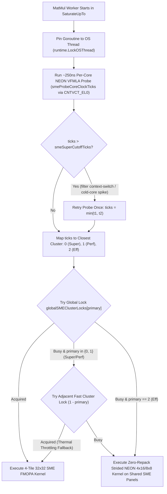

# ARM64 NEON (and SVE/SME) Matrix Multiplication (`matmul`) Optimization Plan & Log

This document tracks the architecture analysis, baseline benchmarks, microkernel design, register-allocation verification methodology, and cache-tuning plan for the ARM64 NEON `DotGeneral` (`matmul`) implementation in `internal/gobackend/dot/matmul/neon`.

It serves as a companion to [README.md](./README.md) (which documents the AVX-512 and AVX2 optimizations) and as a running engineering log of our discoveries on ARM64.

---

## 1. Hardware & ISA Overview

### 1.1 ARM64 NEON Register File & Instructions

Although ARM64 NEON vectors are 128 bits wide (4× `float32`, 2× `float64`, 8× `float16`/`bfloat16`), the ARM64 SIMD architecture provides several key advantages for GEMM microkernels:

1. **32 Vector Registers (`V0`–`V31`)**:
   - Unlike AVX2 (which has only 16 YMM registers) and like AVX-512 (32 ZMM registers), ARM64 NEON provides **32 128-bit registers** (`V0`–`V31`).
   - This allows dedicating **16 to 24 registers purely to accumulators** while still having 8–16 registers available for double-buffered (ping-pong) LHS and RHS vector loads, completely hiding L1D load latency without stack spills.
2. **Non-Destructive Lane-Indexed FMA (`FMLA Vd.4S, Vn.4S, Vm.S[lane]`)**:
   - On x86 AVX2/AVX-512, broadcasting an LHS scalar across a vector requires either a separate `VBROADCASTSS` instruction or a memory broadcast operand.
   - On ARM64 NEON, `FMLA Vd.4S, Vn.4S, Vm.S[lane]` (`lane` $\in \{0, 1, 2, 3\}$) multiplies the 4-float RHS vector `Vn.4S` by a single scalar lane `Vm.S[lane]` of an LHS vector register and accumulates into `Vd.4S` in a single instruction.
   - Because one `VLD1` loads 4 LHS values into `Vm.4S` (either 4 rows for a single $k$ in `Mr=4/8` packed LHS, or 4 consecutive $k$ steps for a single row in `SmallNonTransposed`), a single 128-bit LHS load feeds **4 consecutive lane-indexed `FMLA` instructions** without any `VDUP` broadcast instructions.
3. **Multi-Register Post-Increment Loads & Stores (`VLD1.P` / `VST1.P`)**:
   - A single `VLD1.P (Rn), [Vt.4S, Vt+1.4S, Vt+2.4S, Vt+3.4S]` loads 64 bytes (16× `float32` or 32× `float16`/`bfloat16`) into 4 consecutive vector registers and advances the base pointer `Rn` in one instruction.
4. **In-Register Matrix Transposition (`TRN1`, `TRN2`, `ZIP1`, `ZIP2`)**:
   - `TRN1` / `TRN2` on `.4S` interleave even/odd 32-bit elements, and `TRN1` / `TRN2` on `.2D` (or `ZIP1` / `ZIP2`) swap 64-bit pairs, transposing a $4 \times 4$ `float32` tile in register in just 8 instructions.
5. **Half-Precision Hardware Support**:
   - **`FEAT_FP16`**: Hardware `FCVTL` (`V.4H -> V.4S`) and `FCVTL2` (`V.8H -> V.4S`) widen 8× `float16` to two 4× `float32` vectors in 2 instructions.
   - **`FEAT_BF16`**: `SHLL Vd.4S, Vn.4H, #16` and `SHLL2 Vd.4S, Vn.8H, #16` widen 8× `bfloat16` to two 4× `float32` vectors in 2 instructions; additionally, `BFDOT` (2-way `bfloat16` dot product into `float32`) and `BFMMLA` ($2 \times 4 \times 2$ matrix multiply-accumulate) are available when `gobackend.IsARM64BF16Allowed` is true.

### 1.2 Test Host Hardware Topology (Apple M6)

Queried via `sysctl` on the `darwin/arm64` benchmark host:

| Parameter | Super Cores (`perflevel0`) | Performance Cores (`perflevel1`) | Efficiency Cores (`perflevel2`) |
| :--- | :--- | :--- | :--- |
| **Core Count** | 2 physical / 2 logical | 4 physical / 4 logical | 6 physical / 6 logical |
| **Total Logical CPUs** | 12 (`parallelism=12`) | — | — |
| **Cache Line Size** | 128 bytes | 128 bytes | 128 bytes |
| **L1 Instruction Cache** | 192 KB per core | 128 KB per core | 160 KB per core |
| **L1 Data Cache (L1D)** | **128 KB** per core | **64 KB** per core | **96 KB** per core |
| **L2 Cache (Shared)** | **20 MB** (shared by 2) | **20 MB** (shared by 4) | **8 MB** (shared by 6) |

> **Implication for Cache Blocking ($K_c, M_c, N_c$)**:
> - The minimum P-core L1D size is **64 KB** (with Super cores at 128 KB and E-cores at 96 KB), which is $1.33\times$ to $2.66\times$ larger than x86 Zen/Golden Cove L1D (32–48 KB).
> - Cache lines on Apple Silicon are **128 bytes** (32× `float32`), while standard ARM64 server CPUs (AWS Graviton3/4 Neoverse V1/V2) use 64-byte cache lines and 64 KB L1D / 1–2 MB private L2.
> - Keeping the L1 working set (1 RHS strip of $K_c \times N_r$ + 1–2 LHS strips of $M_r \times K_c$) under **32–48 KB** ensures zero L1D thrashing on both 64 KB P-cores/Neoverse cores and 128 KB Super cores.

---

## 2. Baseline Benchmarks (No-SIMD Portable Go)

Before introducing `internal/gobackend/dot/matmul/neon`, we recorded the baseline performance of the portable Go `simd:nosimd` implementation (`NoSIMDParams`: `Mr=2, Nr=4, Kc=512, Mc=2, Nc=512`) on the 12-core Apple M6 host.

### 2.1 Reproduction Commands

```bash
# 1. Full DotGeneral compliance benchmark suite:
GOOS=darwin GOARCH=arm64 GOEXPERIMENT=simd go test -run=none -bench="BenchmarkCompliance/DotGeneral" -benchtime=300ms ./gobackend

# 2. Internal NoSIMD Small MatMul & Packing benchmarks:
GOOS=darwin GOARCH=arm64 GOEXPERIMENT=simd go test -run=none -bench="BenchmarkSmallNoSIMD|BenchmarkNoSIMD" -benchtime=500ms ./internal/gobackend/dot/matmul
```

### 2.2 Baseline: Large Matrix Multiplication (`BenchmarkCompliance/DotGeneral/Large`)

| Benchmark Case | LHS Shape | RHS Shape | Layout | Time / op | Throughput (`GFlops/s`) |
| :--- | :--- | :--- | :--- | ---: | ---: |
| `NoBatch-Large-1` | `[1536, 1920]` | `[1920, 1024]` | NonTransposed | 58.30 ms | **103.6 GFlops/s** |
| `NoBatch-Large-2` | `[1024, 1920]` | `[1920, 1536]` | NonTransposed | 57.60 ms | **104.8 GFlops/s** |
| `NoBatch-Large-3` | `[2048, 2048]` | `[2048, 2048]` | NonTransposed | 160.60 ms | **107.0 GFlops/s** |
| `Batched-Large-1` | `[16, 1536, 1920]` | `[16, 1920, 1024]` | NonTransposed | 998.40 ms | **96.79 GFlops/s** |
| `Batched-Large-2` | `[16, 1024, 1920]` | `[16, 1920, 1536]` | NonTransposed | 1000.00 ms | **95.14 GFlops/s** |

### 2.3 Baseline: Transformer Models (`KA-all-MiniLM-L6-v2` & `BAAI-bge-small-en-v1.5`)

| Model / Benchmark Case | Shapes | Layout | Time / op | Throughput (`GFlops/s`) |
| :--- | :--- | :--- | ---: | ---: |
| **KA-all-MiniLM-L6-v2** | | | | |
| `32x12x13x13_x_32x12x13x32` | `[32,12,13,13] × [32,12,13,32]` | NonTransposed | 140.4 µs | **29.58 GFlops/s** |
| `32x12x13x32_x_32x12x32x13` | `[32,12,13,32] × [32,12,32,13]` | NonTransposed | 131.5 µs | **31.59 GFlops/s** |
| `NonTransposed:32x13x1536_x_1536x384` | `[32,13,1536] × [1536,384]` | NonTransposed | 5.00 ms | **97.32 GFlops/s** |
| `Transposed:32x13x1536_x_384x1536` | `[32,13,1536] × [384,1536]` | Transposed | 4.90 ms | **99.49 GFlops/s** |
| `32x13x384_x_384x1152` | `[32,13,384] × [384,1152]` | NonTransposed | 3.80 ms | **97.03 GFlops/s** |
| `32x13x384_x_384x1536` | `[32,13,384] × [384,1536]` | NonTransposed | 5.00 ms | **98.84 GFlops/s** |
| `32x13x384_x_384x384` | `[32,13,384] × [384,384]` | NonTransposed | 1.30 ms | **95.00 GFlops/s** |
| `416x384_x_384x1152` | `[416,384] × [384,1152]` | NonTransposed | 3.80 ms | **97.06 GFlops/s** |
| **BAAI-bge-small-en-v1.5** | | | | |
| `Incompatible:10x192x12x192_x_10x192x12x32` | `[10,192,12,192] × [10,192,12,32]` | General | 3.30 ms | **86.98 GFlops/s** |
| `Transposed:10x192x1536_x_384x1536` | `[10,192,1536] × [384,1536]` | Transposed | 21.90 ms | **103.4 GFlops/s** |
| `Transposed:10x192x384_x_1536x384` | `[10,192,384] × [1536,384]` | Transposed | 22.10 ms | **102.4 GFlops/s** |
| `Transposed:10x192x384_x_384x384` | `[10,192,384] × [384,384]` | Transposed | 5.70 ms | **99.80 GFlops/s** |
| `16x128x12x128_x_16x128x12x32` | `[16,128,12,128] × [16,128,12,32]` | General | 2.40 ms | **84.66 GFlops/s** |
| `16x128x12x32_x_16x128x12x32` | `[16,128,12,32] × [16,128,12,32]` | Transposed | 2.30 ms | **86.64 GFlops/s** |
| `16x128x1536_x_384x1536` | `[16,128,1536] × [384,1536]` | Transposed | 23.50 ms | **102.9 GFlops/s** |
| `16x128x384_x_1536x384` | `[16,128,384] × [1536,384]` | Transposed | 23.80 ms | **101.6 GFlops/s** |
| `16x128x384_x_384x384` | `[16,128,384] × [384,384]` | Transposed | 6.00 ms | **100.0 GFlops/s** |
| `256x8x12x8_x_256x8x12x32` | `[256,8,12,8] × [256,8,12,32]` | General | 485.2 µs | **25.93 GFlops/s** |
| `32x64x12x64_x_32x64x12x32` | `[32,64,12,64] × [32,64,12,32]` | General | 1.30 ms | **78.39 GFlops/s** |
| `42x48x12x48_x_42x48x12x32` | `[42,48,12,48] × [42,48,12,32]` | General | 990.7 µs | **75.01 GFlops/s** |
| `8x256x12x256_x_8x256x12x32` | `[8,256,12,256] × [8,256,12,32]` | General | 4.60 ms | **86.71 GFlops/s** |
| `85x24x12x24_x_85x24x12x32` | `[85,24,12,24] × [85,24,12,32]` | General | 671.8 µs | **55.97 GFlops/s** |

### 2.4 Baseline: Small Matrices (`adult-demo`, `test-cases`, and Direct `BenchmarkSmallNoSIMD`)

| Benchmark Suite & Case | DType | Layout | Time / op (Full Graph) | `GFlops/s` (Full Graph) | Direct Kernel Time | Direct Kernel `GFlops/s` |
| :--- | :--- | :--- | ---: | ---: | ---: | ---: |
| `[128, 4] × [4, 1]` | `Float32` | NonTransposed | 799.0 ns | 1.28 GFlops/s | 93.0 ns | **10.94 GFlops/s** |
| `[128, 69] × [69, 4]` | `Float32` | NonTransposed | 7.74 µs | 9.13 GFlops/s | 3.90 µs | **18.13 GFlops/s** |
| `[25, 4] × [4, 1]` | `Float32` | NonTransposed | 792.0 ns | 0.25 GFlops/s | 27.0 ns | **7.26 GFlops/s** |
| `[25, 69] × [69, 4]` | `Float32` | NonTransposed | 1.73 µs | 8.00 GFlops/s | 916.0 ns | **15.06 GFlops/s** |
| `[49, 4] × [4, 1]` | `Float32` | NonTransposed | 796.0 ns | 0.49 GFlops/s | 42.0 ns | **9.12 GFlops/s** |
| `[49, 69] × [69, 4]` | `Float32` | NonTransposed | 2.44 µs | 11.07 GFlops/s | 1.62 µs | **16.68 GFlops/s** |
| `[128, 4] × [1, 4]` | `Float32` | Transposed | 799.0 ns | 1.28 GFlops/s | 93.0 ns | **11.00 GFlops/s** |
| `[128, 69] × [4, 69]` | `Float32` | Transposed | 7.87 µs | 8.98 GFlops/s | 3.77 µs | **18.75 GFlops/s** |
| `[25, 4] × [1, 4]` | `Float32` | Transposed | 780.0 ns | 0.26 GFlops/s | 27.0 ns | **7.27 GFlops/s** |
| `[25, 69] × [4, 69]` | `Float32` | Transposed | 1.49 µs | 9.28 GFlops/s | 756.0 ns | **18.24 GFlops/s** |
| `[49, 4] × [1, 4]` | `Float32` | Transposed | 791.0 ns | 0.50 GFlops/s | 43.0 ns | **9.09 GFlops/s** |
| `[49, 69] × [4, 69]` | `Float32` | Transposed | 2.27 µs | 11.93 GFlops/s | 1.46 µs | **18.56 GFlops/s** |
| `[32, 20] × [20, 64]` | `Float32` | NonTransposed | 8.04 µs | **10.20 GFlops/s** | — | — |
| `[32, 20] × [20, 64]` | `BFloat16` | NonTransposed | 23.36 µs | **3.51 GFlops/s** | — | — |

### 2.5 Baseline: Packing Throughput (`BenchmarkNoSIMD` on `1536 × 1920`, panel `24 × 128`)

| Operation | Kernel Size | `Float32` (Standard) | `Float32` (Unsafe) | `BFloat16` (Standard) | `BFloat16` (Unsafe) |
| :--- | :--- | ---: | ---: | ---: | ---: |
| `PackLHS` | `kernelRows=2` | 681.8 µs | 342.4 µs | 676.5 µs | 358.7 µs |
| `PackLHS` | `kernelRows=4` | 687.3 µs | **278.1 µs** | 708.3 µs | **329.0 µs** |
| `PackLHS` | `kernelRows=8` | 676.1 µs | 389.5 µs | 677.3 µs | 523.1 µs |
| `PackLHS` | `kernelRows=32` | 878.4 µs | 873.8 µs | 874.4 µs | 876.0 µs |
| `PackRHS` | `kernelCols=4` | 1,057.9 µs | **198.4 µs** | 1,058.6 µs | **230.3 µs** |

---

## 3. Methodology: Verifying Go SIMD (`simd` / `archsimd`) vs. Plan9 Assembly

In AVX-512 (documented in [README.md](./README.md)), writing the large GEMM microkernel purely in Go `archsimd` encountered two compiler code-generation bottlenecks that limited throughput compared to handwritten assembly:
1. **Destructive FMA (`MulAdd`)**: In `archsimd`, `a.MulAdd(b, c)` computes `a * b + c` and overwrites `a` (the multiplicand) rather than accumulating into `c` (`VFMADD213PS` vs `VFMADD231PS`), forcing the Go compiler to emit extra register-to-register `VMOV` instructions inside the inner $k$ loop to preserve `a` or copy the result back to `c`.
2. **Register Allocator Spills**: When holding 16–24 vector accumulator variables plus LHS/RHS vector variables live across a loop back-edge, Go's SSA register allocator spilled vector registers to the stack (`(SP)`), introducing L1 memory traffic inside the innermost compute loop.

### 3.1 How We Inspect Generated ARM64 Assembly

Whenever we write or modify a Go `simd` / `archsimd` kernel in `internal/gobackend/dot/matmul/neon`, we will compile the test binary and disassemble the target function before and during benchmarking:

```bash
# 1. Compile the neon test binary with DWARF/symbol table intact:
GOOS=darwin GOARCH=arm64 GOEXPERIMENT=simd go test -c -o /tmp/neon_matmul.test ./internal/gobackend/dot/matmul/neon

# 2. Disassemble the Go SIMD microkernel using Go's objdump:
GOOS=darwin GOARCH=arm64 GOEXPERIMENT=simd go tool objdump -s "neonLarge.*Kernel" /tmp/neon_matmul.test

# 3. Alternatively, inspect compiler SSA / assembly listing directly with -gcflags="-S":
GOOS=darwin GOARCH=arm64 GOEXPERIMENT=simd go build -gcflags="-S" ./internal/gobackend/dot/matmul/neon 2>&1 | grep -A 120 "neonLarge.*Kernel.*STEXT"
```

### 3.2 Assembly Inspection Checklist

When examining the `go tool objdump` output of the inner $k$ loop of a Go SIMD microkernel, we check three specific criteria:

1. **Zero Stack Spills in the Inner Loop**:
   - Search the inner $k$ loop instructions for stack pointer references (`(RSP)`).
   - Any `VST1`, `VLD1`, `FMOVD`, `FMOVQ`, `MOVD`, or `STP`/`LDP` referencing `...(RSP)` inside the `k` loop body means the register allocator ran out of `V0`–`V31` registers and spilled accumulators to the stack.
   - Quick one-liner check:
     ```bash
     GOOS=darwin GOARCH=arm64 GOEXPERIMENT=simd go tool objdump -s "neonLarge.*Kernel" /tmp/neon_matmul.test | grep "(RSP)"
     ```
     (Should only appear in the function prologue/epilogue if at all, **never** between the inner loop label and its backward branch.)
2. **No Redundant Register Moves (`VMOV`) per FMA**:
   - Count the ratio of `FMLA` instructions to `VMOV` instructions in the inner loop body.
   - In an optimal microkernel, each accumulator update is a single `FMLA Vd.4S, Vn.4S, Vm.S[lane]` (or `FMLA Vd.4S, Vn.4S, Vm.4S`) with **zero** `VMOV` copies.
   - If Go's `MulAdd` emits `VMOV` + `FMLA` for every accumulator (doubling the instruction count in the inner loop), handwritten Plan9 ARM64 assembly will eliminate all `VMOV`s.
3. **Lane-Indexed `FMLA` vs. Explicit `VDUP` Broadcasts**:
   - Check whether broadcasting an LHS element in Go (`archsimd` broadcast + `MulAdd`) emits a separate `VDUP` instruction for every LHS row, or fuses into ARM64's single-instruction lane-indexed `FMLA Vd.4S, Vn.4S, Vm.S[lane]`.
   - In handwritten Plan9 ARM64 assembly (or `WORD` encodings where needed), we can load 4 LHS rows into a single register `V20.4S` (`VLD1.P 16(R0), [V20.4S]`) and issue 4 lane-indexed FMAs (`V20.S[0]`, `V20.S[1]`, `V20.S[2]`, `V20.S[3]`), cutting LHS load + broadcast instructions by $4\times$.

### 3.3 Dual-Path Design (`NEONUseAsm` / `GOMLX_GO_NEON_ASM`)

Following the exact pattern of `AVX512UseAsm` (`GOMLX_GO_AVX512_ASM`) and `AVX2UseAsm` (`GOMLX_GO_AVX2_ASM`):
- `neon.NEONUseAsm` (`GOMLX_GO_NEON_ASM`, default `true`) will toggle between the handwritten Plan9 assembly microkernels/packers and the pure-Go `archsimd` implementations.
- Every unit test in `internal/gobackend/dot/matmul/neon/internal_test.go` will test **both** `NEONUseAsm = false` (Go SIMD) and `NEONUseAsm = true` (Plan9 assembly) for bit-exact agreement against the reference implementation.

---

## 4. Step-by-Step Optimization & Benchmarking Plan

### Stage 1: Package Scaffolding & Alternates Generator (`internal/gobackend/dot/matmul/neon`)

1. Create `internal/gobackend/dot/matmul/neon` with `//go:build arm64 && goexperiment.simd` and `//go:generate` directives using `internal/cmd/alternates_generator` (`-tags=bf16,f16,f64`), matching `avx2` and `avx512`:
   - `neon.go`: Cache parameters (`NEONParamsFloat32`, `NEONParamsBFloat16`, `NEONParamsFloat16`, `NEONParamsFloat64`), `NEONUseAsm`, env overrides (`GOMLX_GO_NEON_KC`, `GOMLX_GO_NEON_MC`, `GOMLX_GO_NEON_NC`), registration at `matmul.PriorityNEON`, and `neonApplyPackedOutputFloat32` / `Float64`.
   - `router.go` (+ generated `bf16`, `f16`, `f64` variants): Dispatches between `neonSmall*` and `neonLarge*` based on matrix size and flop thresholds.
   - Blank-import `internal/gobackend/dot/matmul/neon` in `internal/gobackend/defaultpkgs/defaultpkgs_arm64_simd.go`.

### Stage 2: Microkernel Register Tile Exploration ($M_r \times N_r$)

Because ARM64 NEON has **32 vector registers (`V0`–`V31`)**, each holding 4× `float32` (or 2× `float64`), we have three primary candidate microkernel geometries for `Float32` (and `Float16`/`BFloat16` accumulating into `Float32`):

| Candidate | Tile ($M_r \times N_r$) | Accumulators | RHS Regs | LHS Regs | Total Regs | Compute-to-Load Ratio | Pros & Cons |
| :--- | :--- | :--- | :--- | :--- | :--- | :--- | :--- |
| **Candidate A** | **$8 \times 12$** (8 rows × 3 vecs) | **24** (`V0`–`V23`) | 3 (`V24`–`V26`) | 2 (`V28`–`V29`) | 29 / 32 | **24 FMAs / 5 loads (4.8)** | Highest arithmetic intensity per L1 load; **downside**: $N_r = 12$ is not a power of 2, so power-of-two $N$ ($64, 128, 256, 512, 1024, 2048$) always hits a partial tail strip (`needTempOutput = true`). |
| **Candidate B** | **$8 \times 8$** (8 rows × 2 vecs) | **16** (`V0`–`V15`) | 4 (`V16`–`V19`, 2× ping-pong) | 4 (`V20`–`V23`, 2× ping-pong) | 24 / 32 | **16 FMAs / 4 loads (4.0)** | Power-of-two $M_r=8, N_r=8$ enables **zero-copy direct output** (`needTempOutput = false`) on all multiples of 8; 16 accumulators exceed the 4-cycle FMA latency; room for 2-stage ping-pong register prefetching. |
| **Candidate C** | **$4 \times 16$** (4 rows × 4 vecs) | **16** (`V0`–`V15`) | 4 (`V16`–`V19`) | 1–2 (`V20`–`V21`) | 22 / 32 | **16 FMAs / 5 loads (3.2)** | Power-of-two $M_r=4, N_r=16$; 64-byte RHS strip (single 4-register `VLD1.P` load); reuses simple 4-row `PackLHS` (`Mr=4`); better utilization on small $M \in [4, 32]$. |

#### Plan for Stage 2:
1. First implement and benchmark the pure-Go `archsimd` microkernel (starting with $4 \times 16$ and $8 \times 8$) and inspect its disassembly via `go tool objdump` (Section 3.1) to see if Go's register allocator spills or emits extra `VMOV`s.
2. Implement handwritten Plan9 ARM64 assembly microkernels for the top candidates (**$8 \times 8$**, **$4 \times 16$**, and **$8 \times 12$**) in `internal/gobackend/dot/matmul/neon/large_arm64_float32.s` and benchmark them head-to-head in `BenchmarkMicrokernels` across:
   - Pure L1 panel (`32 × 64 × 192` and `64 × 128 × 192`)
   - Square power-of-two matrices (`1024 × 1024`, `2048 × 2048`) where `needTempOutput = false` for $8 \times 8$ and $4 \times 16$
   - Transformer shapes (`384 × 1536`, `416 × 384 × 1152`)
3. For `Float64` (2 doubles per register), evaluate **$8 \times 4$** (8 rows × 2 vecs = 16 accumulators `V0`–`V15`) vs. **$4 \times 8$** (4 rows × 4 vecs = 16 accumulators `V0`–`V15`).

### Stage 3: Fast NEON Packing (`PackLHS` & `PackRHS`)

As seen in AVX-512 and AVX2, once the microkernel reaches high GFlops/s, `PackLHS` (which transposes $M_r \times K_c$ into contiguous $M_r$-element strips) and `PackRHS` can become a significant fraction of execution time for uncached dynamic inputs.

1. **`neonPackLHS`**:
   - For $M_r = 4$: Load 4 rows of 4 floats (`V0`–`V3`), transpose $4 \times 4$ in-register using `TRN1` / `TRN2` (`.4S`) and `ZIP1` / `ZIP2` (`.2D`), and store 4 contiguous columns (`VST1.P [V0.4S, V1.4S, V2.4S, V3.4S]`).
   - For $M_r = 8$: Transpose two $4 \times 4$ blocks in registers (`V0`–`V3` for rows 0–3 and `V4`–`V7` for rows 4–7) and interleave their stores so each $k$ step has 8 contiguous floats (`row0..row7`).
   - Benchmark against `unsafePackLHS` (`278.1 µs` for $M_r=4$, `389.5 µs` for $M_r=8$ on `1536 × 1920`).
2. **`neonPackRHSNonTransposed`**:
   - Use multi-register `VLD1.P` / `VST1.P` (32 bytes for $N_r=8$, 64 bytes for $N_r=16$) unrolled by 4 rows to saturate memory copy bandwidth.
   - Benchmark against `unsafePackRHS` (`198.4 µs` on `1536 × 1920`).

### Stage 4: Cache Blocking Grid Search ($K_c, M_c, N_c$)

Once the winning microkernel ($M_r \times N_r$) and fast packers are in place, we will run a systematic grid search using the environment variables `GOMLX_GO_NEON_KC`, `GOMLX_GO_NEON_MC`, and `GOMLX_GO_NEON_NC`:

- **$K_c$ (`PanelContractingSize`)**: Sweep $\{128, 192, 256, 384, 512\}$.
  - At $K_c = 256$ (`Float32`), one RHS strip ($256 \times 16 \times 4\text{ B} = 16\text{ KB}$) + one LHS strip ($8 \times 256 \times 4\text{ B} = 8\text{ KB}$) = **24 KB**, which fits comfortably inside both 64 KB P-core/Neoverse L1D and 128 KB Super-core L1D.
- **$M_c$ (`LHSPanelCrossSize`)**: Sweep $\{16, 32, 48, 64, 96, 128\}$.
  - Larger $M_c$ increases RHS strip reuse across rows, while smaller $M_c$ (e.g. $32$ or $64$) produces more fine-grained 2D work items (`Choose2DSplit`) for 12-core parallel saturation.
- **$N_c$ (`RHSPanelCrossSize`)**: Sweep $\{256, 384, 512, 768, 1024\}$.
  - Tuned so the $K_c \times N_c$ RHS panel + $M_c \times N_c$ accumulation buffer stay resident in L2 cache while providing enough column chunks for multi-core parallelism.

### Stage 5: Small Matrix Path (`small.go`, `small_nontransposed`, `small_transposed`)

For matrices below `SmallMatMulSizeThreshold` (such as `adult-demo` and per-head attention $Q K^T$ / $\text{scores} \times V$ in `KA-all-MiniLM-L6-v2` and `BAAI-bge-small-en-v1.5`), panel packing overhead is avoided completely:

1. **`neonSmallNonTransposed`**:
   - Register-tiled microkernels (`Tile4x16`, `Tile4x8`, `Tile1x16`, `Tile1x8`, `Tile4x4`, `Tile1x4`) operating directly on strided `lhs` and `rhs` slices without packing.
   - Narrow-$N$ transposition shortcut: when $N < 8$ (e.g. `adult-demo` with $N=4$ and $K=69$), transpose `rhs` `[K, N] -> [N, K]` into a stack-allocated buffer (`var buf [512]float32`) and delegate to `neonSmallTransposed`.
   - GEMV ($N=1$) zero-copy shortcut: when $N=1$, `[K, 1]` and `[1, K]` have identical memory layout, so route directly to `neonSmallTransposed` with zero copy.
2. **`neonSmallTransposed`**:
   - Compute 4×2 or 4×4 dot products simultaneously in registers along the contiguous $K$ dimension, finishing with fast NEON pairwise horizontal reductions (`FADDP`).
3. **Crossover & Parallelism Threshold Calibration**:
   - Calibrate `SmallMatMulSizeThreshold`, `MinMatMulFlopsPerWorker`, and `MinLargeMatMulFlopsPerWorker` for ARM64.

### Stage 6: Half-Precision (`Float16` & `BFloat16`) & Future SME/SVE

1. **`Float16` -> `Float32` Microkernels**:
   - Pack LHS and RHS in native 16-bit `float16.Float16` (halving L1/L2 cache footprint and memory bandwidth).
   - Inside the microkernel inner loop, widen 8× `float16` to two 4× `float32` vectors on the fly using `FCVTL` and `FCVTL2` (`FEAT_FP16`), then accumulate into `Float32` registers via `FMLA`.
2. **`BFloat16` -> `Float32` Microkernels**:
   - Pack LHS and RHS in native 16-bit `bfloat16.BFloat16`.
   - On-the-fly widening via `SHLL Vd.4S, Vn.4H, #16` and `SHLL2 Vd.4S, Vn.8H, #16` followed by `FMLA` (and evaluate `BFDOT` / `BFMMLA` when `gobackend.IsARM64BF16Allowed` is true).
3. **Future SVE / SME Investigation**:
   - Note that the Apple M6 host reports `FEAT_SME` and `FEAT_SME2` (`gobackend.IsSMEAllowed == true`)! Once the NEON (`PriorityNEON`) foundation is complete and benchmarked, we can explore an SME outer-product (`FMOPA`) kernel registered at `PrioritySME`.

---

## 5. Stage 1 & Stage 2 Results: Scaffolding, Disassembly Analysis & Microkernel Benchmarks

### 5.1 Stage 1 Completed: Package Scaffolding & Alternates Generator

Created `internal/gobackend/dot/matmul/neon` (`//go:build arm64 && goexperiment.simd`) and registered `"simd:neon"` at `matmul.PriorityNEON` (`10`):

- **`neon.go`**:
  - `NEONUseAsm` flag (`GOMLX_GO_NEON_ASM`, default `true`).
  - Per-dtype `matmul.CacheParams` (`NEONParamsFloat32`, `NEONParamsFloat16`, `NEONParamsBFloat16`, `NEONParamsFloat64`) with runtime environment overrides (`GOMLX_GO_NEON_KC`, `GOMLX_GO_NEON_MC`, `GOMLX_GO_NEON_NC`, `GOMLX_GO_NEON_MR`, `GOMLX_GO_NEON_NR`).
  - `neonPackLHS`, `neonPackRHSNonTransposed`, `neonApplyPackedOutputFloat32`, `neonApplyPackedOutputFloat64`.
- **`router.go`, `small.go`, `large.go`** (+ 9 generated files `gen_{router,small,large}_{bf16,f16,f64}.go` via `alternates_generator`):
  - Full 5-loop GotoBLAS/BLIS cache-tiled GEMM with `backend.Scheduler.RunIntraOpTasks` 2D work-stealing, per-batch atomic panel caching, and zero-copy direct output when `needTempOutput == false`.
- **`large_arm64.go` & Plan9 ARM64 Assembly Microkernels**:
  - `large_arm64_float32.s`: `neonLargeKernelFloat32Asm` ($8 \times 8$), `neonLargeKernelFloat32Asm_4x16` ($4 \times 16$), and `neonLargeKernelFloat32Asm_8x12` ($8 \times 12$).
  - `large_arm64_float16.s`: `neonLargeKernelFloat16Asm` ($8 \times 8$) and `neonLargeKernelFloat16Asm_4x16` ($4 \times 16$) with on-the-fly `FCVTL` / `FCVTL2` widening into `Float32` accumulators.
  - `large_arm64_bfloat16.s`: `neonLargeKernelBFloat16Asm` ($8 \times 8$) and `neonLargeKernelBFloat16Asm_4x16` ($4 \times 16$) with on-the-fly `SHLL` / `SHLL2` (`#16`) widening into `Float32` accumulators.
  - `large_arm64_float64.s`: `neonLargeKernelFloat64Asm` ($8 \times 4$) and `neonLargeKernelFloat64Asm_4x8` ($4 \times 8$).

### 5.2 Stage 2 Disassembly Findings: Go `archsimd` vs. Plan9 ARM64 Assembly

We compiled `internal/gobackend/dot/matmul/neon` into a test binary and inspected the generated machine code of the three Go `archsimd` microkernels (`neonLargeKernelFloat32` [$4 \times 16$], `neonLargeKernelFloat32_8x8` [$8 \times 8$], and `neonLargeKernelFloat32_8x12` [$8 \times 12$]) using `go tool objdump`:

| Kernel Geometry & Implementation | Accumulator Regs | Total Regs Used | Stack Spills in $k$-Loop (`(RSP)`) | Instructions per $k$-Step | Key Code Generation Finding |
| :--- | :---: | :---: | :---: | :---: | :--- |
| **`GoSIMD_4x16`** (`neonLargeKernelFloat32`) | 16 (`V0, V3..V17`) | 23 / 32 | **0** | **54** | Non-destructive `VFMLA Vd.4S, Vn.4S, Vm.4S` avoids accumulator `VMOV`s and spills; **however**, each of the 4 `BroadcastFloat32x4` calls expands into **4 instructions** (`FMOVS` $\to$ `VMOV` $\to$ `VMOV.S[0]` $\to$ `VDUP.S4` = 16 instructions). |
| **`GoSIMD_8x8`** (`neonLargeKernelFloat32_8x8`) | 16 (`V0, V3..V17`) | 27 / 32 | **0** | **73** | Zero stack spills, but 8 scalar LHS broadcasts expand into **32 broadcast instructions** (`8 × 4`) per $k$-step, making it slower than `GoSIMD_4x16`. |
| **`GoSIMD_8x12`** (`neonLargeKernelFloat32_8x12`) | 24 (4 spilled) | > 32 (35 live) | **13 `FMOVQ ...(RSP)`** | **95** | 24 accumulators + 3 RHS + 8 LHS broadcasts exceeds 32 registers; Go's register allocator **spills 4 accumulators (`F0, F3, F4, F5`) to `16(RSP)..80(RSP)` inside the $k$-loop**. |
| **`Asm_4x16`** (`neonLargeKernelFloat32Asm_4x16`) | 16 (`V0`–`V15`) | 26 / 32 (ping-pong) | **0** | **18** | Single `VLD1.P (R4), [V16.S4]` loads all 4 LHS rows; single `VLD1.P (R5), [V17.S4-V20.S4]` loads a full 64-byte RHS cache line; 16 lane-indexed `FMLA_4S_LANE` instructions. **3.0× fewer instructions** than `GoSIMD_4x16`. |
| **`Asm_8x8`** (`neonLargeKernelFloat32Asm`) | 16 (`V0`–`V15`) | 24 / 32 (ping-pong) | **0** | **18** | Single `VLD1.P` loads 8 LHS rows (`V16, V17`); single `VLD1.P` loads 8 RHS cols (`V18, V19`); 16 lane-indexed `FMLA_4S_LANE` instructions. **4.1× fewer instructions** than `GoSIMD_8x8`. |
| **`Asm_8x12`** (`neonLargeKernelFloat32Asm_8x12`) | 24 (`V0`–`V23`) | 29 / 32 | **0** | **27** | Uses 24 accumulators (`V0`–`V23`), 2 LHS regs (`V24`–`V25`), and 3 RHS regs (`V26`–`V28`) = 29 registers with **zero stack spills**. **3.5× fewer instructions** than `GoSIMD_8x12`. |

#### Why Go `archsimd` Expands `BroadcastFloat32x4` to 4 Instructions
In `go tool objdump` of `neonLargeKernelFloat32`, every `archsimd.BroadcastFloat32x4(packedLHS[lhsOff+row])` compiles to:
```assembly
FMOVS (R15), F22          // 1. Load scalar float32 into F22
VMOV V2.B16, V26.B16      // 2. Copy zero vector V2 into V26
VMOV V22.S[0], V26.S[0]   // 3. Insert lane 0 from V22 into V26
VDUP V26.S[0], V22.S4     // 4. Duplicate lane 0 across all 4 lanes of V22
```
Furthermore, Go's `simd/archsimd` API only exposes vector-by-vector `MulAdd(v1, v2)` (`VFMLA Vd.4S, Vn.4S, Vm.4S`), not ARM64's element-indexed `FMLA Vd.4S, Vn.4S, Vm.S[lane]`.

In our Plan9 ARM64 assembly microkernels, we encode element-indexed `FMLA` and half-precision widening instructions directly via verified `WORD` macros:
```c
// FMLA Vd.4S, Vn.4S, Vm.S[lane] (sz=10 at bits [23:22]):
#define FMLA_4S_LANE(Vd, Vn, Vm, lane) \
    WORD $(0x4F801000 | (((lane)&1)<<21) | (((lane)&2)<<10) | ((Vm)<<16) | ((Vn)<<5) | (Vd))

// FMLA Vd.2D, Vn.2D, Vm.D[lane] (sz=11 at bits [23:22]):
#define FMLA_2D_LANE(Vd, Vn, Vm, lane) \
    WORD $(0x4FC01000 | (((lane)&1)<<11) | ((Vm)<<16) | ((Vn)<<5) | (Vd))

// Float16 -> Float32 widening (FCVTL Vd.4S, Vn.4H and FCVTL2 Vd.4S, Vn.8H):
#define FCVTL_4S_4H(Vd, Vn)  WORD $(0x0E217800 | ((Vn)<<5) | (Vd))
#define FCVTL2_4S_8H(Vd, Vn) WORD $(0x4E217800 | ((Vn)<<5) | (Vd))

// BFloat16 -> Float32 widening (SHLL Vd.4S, Vn.4H, #16 and SHLL2 Vd.4S, Vn.8H, #16):
#define SHLL_4S_4H_16(Vd, Vn)  WORD $(0x2E613800 | ((Vn)<<5) | (Vd))
#define SHLL2_4S_8H_16(Vd, Vn) WORD $(0x6E613800 | ((Vn)<<5) | (Vd))
```

### 5.3 Stage 2 Benchmarks: Isolated Microkernels (`BenchmarkMicrokernels`, Single Core, `M=32, N=48, K=256`)

```bash
GOOS=darwin GOARCH=arm64 GOEXPERIMENT=simd go test -run=^$ -bench=BenchmarkMicrokernels -benchtime=500ms ./internal/gobackend/dot/matmul/neon
```

| DType | Kernel Variant | Tile ($M_r \times N_r$) | Time / op | Single-Core Throughput (`GFlops/s`) | Speedup vs. GoSIMD |
| :--- | :--- | :---: | ---: | ---: | ---: |
| **`Float32`** | `GoSIMD_8x8` | $8 \times 8$ | 10.52 µs | 74.72 GFlops/s | 1.00× |
| **`Float32`** | `GoSIMD_8x12` | $8 \times 12$ | 9.65 µs | 81.49 GFlops/s | 1.09× |
| **`Float32`** | `GoSIMD_4x16` | $4 \times 16$ | 8.32 µs | 94.53 GFlops/s | 1.27× |
| **`Float32`** | `Asm_8x8` | $8 \times 8$ | 5.75 µs | 136.7 GFlops/s | **1.83×** |
| **`Float32`** | **`Asm_4x16`** | **$4 \times 16$** | **5.34 µs** | **147.2 GFlops/s** | **1.97×** |
| **`Float32`** | `Asm_8x12` | $8 \times 12$ | 5.20 µs | **151.3 GFlops/s** | **2.02×** |
| **`Float16`** | `GoSIMD_4x16` | $4 \times 16$ | 93.78 µs | 8.39 GFlops/s | 1.00× (scalar `ToFloat32`) |
| **`Float16`** | `GoSIMD_8x8` | $8 \times 8$ | 81.57 µs | 9.64 GFlops/s | 1.15× |
| **`Float16`** | `Asm_4x16` | $4 \times 16$ | 7.24 µs | 108.7 GFlops/s | 12.96× |
| **`Float16`** | **`Asm_8x8`** | **$8 \times 8$** | **6.59 µs** | **119.4 GFlops/s** | **14.23×** |
| **`BFloat16`** | `GoSIMD_8x8` | $8 \times 8$ | 13.40 µs | 58.69 GFlops/s | 1.00× |
| **`BFloat16`** | `GoSIMD_4x16` | $4 \times 16$ | 12.98 µs | 60.58 GFlops/s | 1.03× |
| **`BFloat16`** | `Asm_4x16` | $4 \times 16$ | 7.32 µs | 107.5 GFlops/s | 1.83× |
| **`BFloat16`** | **`Asm_8x8`** | **$8 \times 8$** | **6.55 µs** | **120.0 GFlops/s** | **2.04×** |
| **`Float64`** | `GoSIMD_8x4` | $8 \times 4$ | 21.07 µs | 37.33 GFlops/s | 1.00× |
| **`Float64`** | `GoSIMD_4x8` | $4 \times 8$ | 16.04 µs | 49.04 GFlops/s | 1.31× |
| **`Float64`** | `Asm_4x8` | $4 \times 8$ | 10.73 µs | 73.32 GFlops/s | 1.96× |
| **`Float64`** | **`Asm_8x4`** | **$8 \times 4$** | **10.43 µs** | **75.37 GFlops/s** | **2.02×** |

### 5.4 Stage 2 Benchmarks: Full Tiled GEMM Geometry Comparison (`BenchmarkLargeGeometries`, 12 Cores)

```bash
GOOS=darwin GOARCH=arm64 GOEXPERIMENT=simd go test -run=^$ -bench=BenchmarkLargeGeometries -benchtime=500ms ./internal/gobackend/dot/matmul/neon
```

| Matrix Shape | `GoSIMD_8x8` | `GoSIMD_8x12` | `GoSIMD_4x16` | `Asm_8x12` | `Asm_8x8` | **`Asm_4x16` (Selected Default)** | vs. `nosimd` Baseline |
| :--- | ---: | ---: | ---: | ---: | ---: | ---: | ---: |
| **`Medium [1, 128, 128, 128]`** | 103.7 GFlops/s (40.4 µs) | 91.98 GFlops/s (45.6 µs) | 117.2 GFlops/s (35.8 µs) | 119.6 GFlops/s (35.1 µs) | **149.1 GFlops/s (28.1 µs)** | **145.1 GFlops/s (28.9 µs)** | **6.3× faster** |
| **`Large-1 [1, 1536, 1920, 384]`** | 406.7 GFlops/s (5.57 ms) | 443.9 GFlops/s (5.10 ms) | 543.1 GFlops/s (4.17 ms) | 809.2 GFlops/s (2.80 ms) | 838.6 GFlops/s (2.70 ms) | **850.5 GFlops/s (2.66 ms)** | **8.2× faster** |
| **`Large-3 [1, 2048, 2048, 2048]`** | 420.2 GFlops/s (40.9 ms) | 452.0 GFlops/s (38.0 ms) | 566.2 GFlops/s (30.3 ms) | 816.6 GFlops/s (21.0 ms) | 855.0 GFlops/s (20.1 ms) | **862.3 GFlops/s (19.9 ms)** | **8.1× faster** |

#### Why Different Geometries Win for `Float32` ($4 \times 16$) vs. `Float16`/`BFloat16` ($8 \times 8$):
1. **`Float32` Winner — $4 \times 16$ (`Asm_4x16`)**:
   - Even though `Asm_8x12` achieves slightly higher isolated microkernel throughput (`151.3 GFlops/s` vs `147.2 GFlops/s`), in full end-to-end GEMM `Asm_4x16` (`862.3 GFlops/s`) outperforms both `Asm_8x12` (`816.6 GFlops/s`) and `Asm_8x8` (`855.0 GFlops/s`).
   - **Reasons**:
     1. $N_r = 16$ is a power of two (64 bytes = 4× `Float32x4`), so standard matrix widths ($128, 384, 512, 1024, 1536, 1920, 2048$) divide evenly with zero tail strip overhead (`needTempOutput = false`) and write full 64-byte contiguous vectors per row during store-back, whereas $N_r = 12$ triggers unaligned tail handling on power-of-two widths.
     2. In `Asm_4x16`, a single 4-register `VLD1.P (R5), [V17.S4-V20.S4]` loads 64 bytes of RHS per $k$-step, and storing 16 floats across only 4 output rows (`Mr=4`) halves output row pointer striding compared to `Mr=8`.
2. **`Float16` & `BFloat16` Winner — $8 \times 8$ (`Asm_8x8`)**:
   - For half-precision, 8 `Float16`/`BFloat16` values fit in a single 128-bit register (`V.8H`).
   - In $8 \times 8$, each $k$-step loads one `8H` LHS vector (16 bytes) and one `8H` RHS vector (16 bytes) and widens each into two `4S` `Float32` vectors using **4 widening instructions total** (`2× FCVTL + 2× FCVTL2` or `2× SHLL + 2× SHLL2`).
   - In $4 \times 16$, each $k$-step loads 4 LHS values (1 widening instruction) and 16 RHS values (4 widening instructions) = **5 widening instructions total** per 16 FMAs. Thus $8 \times 8$ achieves **10% higher throughput** (`120.0 GFlops/s` vs `107.5 GFlops/s`).

### 5.5 End-to-End `BenchmarkCompliance/DotGeneral` After Stage 2 (`simd:neon` vs. `simd:nosimd`)

```bash
GOOS=darwin GOARCH=arm64 GOEXPERIMENT=simd go test -run=^$ -bench=BenchmarkCompliance/DotGeneral -benchtime=500ms ./gobackend
```

| Benchmark Case | `simd:nosimd` Baseline | `simd:neon` (Stage 2) | Speedup |
| :--- | ---: | ---: | ---: |
| **Large GEMM** | | | |
| `Large/NoBatch-Large-1` (`[1536,1920]×[1920,1024]`) | 58.30 ms (103.6 GFlops/s) | **7.27 ms (830.5 GFlops/s)** | **8.0×** |
| `Large/NoBatch-Large-2` (`[1024,1920]×[1920,1536]`) | 57.60 ms (104.8 GFlops/s) | **7.40 ms (815.8 GFlops/s)** | **7.8×** |
| `Large/NoBatch-Large-3` (`[2048,2048]×[2048,2048]`) | 160.60 ms (107.0 GFlops/s) | **20.22 ms (849.7 GFlops/s)** | **7.9×** |
| `Large/Batched-Large-1` (`[16,1536,1920]×[16,1920,1024]`) | 998.40 ms (96.79 GFlops/s) | **123.95 ms (779.6 GFlops/s)** | **8.1×** |
| `Large/Batched-Large-2` (`[16,1024,1920]×[16,1920,1536]`) | 1000.00 ms (95.14 GFlops/s) | **124.53 ms (776.0 GFlops/s)** | **8.0×** |
| **KA-all-MiniLM-L6-v2** | | | |
| `NonTransposed:32x13x1536_x_1536x384` | 5.00 ms (97.32 GFlops/s) | **708.1 µs (693.0 GFlops/s)** | **7.1×** |
| `Transposed:32x13x1536_x_384x1536` | 4.90 ms (99.49 GFlops/s) | **845.4 µs (580.5 GFlops/s)** | **5.8×** |
| `32x13x384_x_384x1152` | 3.80 ms (97.03 GFlops/s) | **533.7 µs (689.7 GFlops/s)** | **7.1×** |
| `32x13x384_x_384x1536` | 5.00 ms (98.84 GFlops/s) | **697.8 µs (703.3 GFlops/s)** | **7.1×** |
| `32x13x384_x_384x384` | 1.30 ms (95.00 GFlops/s) | **343.8 µs (356.9 GFlops/s)** | **3.8×** |
| `416x384_x_384x1152` | 3.80 ms (97.06 GFlops/s) | **534.4 µs (688.8 GFlops/s)** | **7.1×** |
| **BAAI-bge-small-en-v1.5** | | | |
| `Incompatible:10x192x12x192_x_10x192x12x32` | 3.30 ms (86.98 GFlops/s) | **796.2 µs (355.6 GFlops/s)** | **4.1×** |
| `Transposed:10x192x1536_x_384x1536` | 21.90 ms (103.4 GFlops/s) | **2.92 ms (776.1 GFlops/s)** | **7.5×** |
| `Transposed:10x192x384_x_1536x384` | 22.10 ms (102.4 GFlops/s) | **2.90 ms (780.6 GFlops/s)** | **7.6×** |
| `Transposed:10x192x384_x_384x384` | 5.70 ms (99.80 GFlops/s) | **825.3 µs (686.1 GFlops/s)** | **6.9×** |
| `16x128x1536_x_384x1536` | 23.50 ms (102.9 GFlops/s) | **3.11 ms (777.6 GFlops/s)** | **7.6×** |
| `16x128x384_x_1536x384` | 23.80 ms (101.6 GFlops/s) | **3.05 ms (792.4 GFlops/s)** | **7.8×** |
| `8x256x12x256_x_8x256x12x32` | 4.60 ms (86.71 GFlops/s) | **1.19 ms (339.1 GFlops/s)** | **3.9×** |
| **Small / Test Cases** | | | |
| `test-cases/non-transposed/float32/[32,20]x[20,64]` | 8.04 µs (10.20 GFlops/s) | **4.01 µs (20.42 GFlops/s)** | **2.0×** |
| `test-cases/non-transposed/bfloat16/[32,20]x[20,64]` | 23.36 µs (3.51 GFlops/s) | **4.24 µs (19.33 GFlops/s)** | **5.5×** |
| `adult-demo/transposed/[128,69]x[4,69]->[128,4]` | 7.87 µs (8.98 GFlops/s) | **2.84 µs (24.87 GFlops/s)** | **2.8×** |

---

## 6. Stage 3 & Stage 4 Results: Fast NEON Packing & Cache Blocking Grid Search

### 6.1 Stage 3 Completed: Fast NEON Packing (`neonPackLHS` & `neonPackRHSNonTransposed`)

Implemented both pure-Go `archsimd` (`InterleaveLo` / `InterleaveHi` $\to$ `ZIP1` / `ZIP2`) and Plan9 ARM64 assembly (`pack_arm64.s`) packers for `kernelRows = 4` and `kernelRows = 8` across `Float32`, `Float16`/`BFloat16`, and `Float64`, as well as 4-row unrolled `neonPackRHSFullStripsAsm` (`kernelColsBytes = 16, 32, 64`).

```bash
GOOS=darwin GOARCH=arm64 GOEXPERIMENT=simd go test -run=^$ -bench=BenchmarkPack -benchtime=500ms ./internal/gobackend/dot/matmul/neon
```

| Operation (`1536 × 1920`) | DType | Strip Width | `UnsafePack` Baseline | `neon` (`GoSIMD`) | `neon` (`Asm`) | Speedup vs. `UnsafePack` |
| :--- | :--- | :---: | ---: | ---: | ---: | ---: |
| `PackLHS` (`panel=24×128`) | `Float32` | `kr=4` | 280.2 µs | 189.8 µs | **186.8 µs** | **1.50×** (and **3.68×** vs standard 687 µs) |
| `PackLHS` (`panel=24×128`) | `Float32` | `kr=8` | 389.3 µs | 170.9 µs | **162.3 µs** | **2.40×** (and **4.17×** vs standard 676 µs) |
| `PackLHS` (`panel=24×128`) | `BFloat16` / `Float16` | `kr=4` | 329.7 µs | **80.0 µs** | 82.5 µs | **4.12×** (and **8.85×** vs standard 708 µs) |
| `PackLHS` (`panel=24×128`) | `BFloat16` / `Float16` | `kr=8` | 522.0 µs | 95.0 µs | **84.2 µs** | **6.20×** (and **8.04×** vs standard 677 µs) |
| `PackLHS` (`panel=24×128`) | `Float64` | `kr=4` | 334.3 µs | **322.2 µs** | 334.4 µs | **1.04×** |
| `PackLHS` (`panel=24×128`) | `Float64` | `kr=8` | 706.8 µs | **304.0 µs** | 340.7 µs | **2.32×** |
| `PackRHS` (`panel=256×512`) | `Float32` | `kc=8` | 210.5 µs | 210.7 µs | **208.0 µs** | **56.8 GB/s** single-core copy |
| `PackRHS` (`panel=256×512`) | `Float32` | `kc=16` | 190.7 µs | 189.8 µs | **178.8 µs** | **66.0 GB/s** single-core copy (**1.07×** vs `Unsafe`) |

> **Microarchitectural Finding on Apple Silicon Store Execution (`VST1.P`)**:
> In `neonPackLHSKernelRows4Float32Asm`, issuing four single-register post-increment stores (`VST1.P [V16.S4], 16(R1)` .. `VST1.P [V19.S4], 16(R1)`) is faster than a single 4-register `VST1.P [V16.S4-V19.S4], 64(R1)` (`186.8 µs` vs `192.1 µs`), because single-register 128-bit stores dispatch across all 4 store pipelines in parallel without multi-register micro-op cracked dispatch.

### 6.2 Stage 4 Completed: Cache Blocking Grid Search ($K_c, M_c, N_c$)

We swept $K_c \in \{128, 192, 256, 384, 512\}$, $M_c \in \{16, 32, 48, 64, 96, 128\}$, and $N_c \in \{128, 256, 384, 512, 768, 1024\}$ on 3 representative shapes (`Transformer [416×1152×384]`, `Large-1 [1536×1024×1920]`, and `Large-3 [2048×2048×2048]`):

```bash
GOOS=darwin GOARCH=arm64 GOEXPERIMENT=simd go test -run=^$ -bench=BenchmarkCacheGridSearch -benchtime=500ms ./internal/gobackend/dot/matmul/neon
```

#### 1. $K_c$ (`PanelContractingSize`) Sweep (with $M_c=32, N_c=512$):
| $K_c$ | `Transformer [416×1152×384]` | `Large-1 [1536×1024×1920]` | `Large-3 [2048×2048×2048]` | L1 Working Set ($1\times$ RHS strip + $1\times$ LHS strip) |
| :---: | ---: | ---: | ---: | :--- |
| `128` | 740.6 GFlops/s (496.9 µs) | 841.2 GFlops/s (7.18 ms) | 862.1 GFlops/s (19.93 ms) | 10 KB (too small; extra accumulation passes) |
| `192` | 759.7 GFlops/s (484.5 µs) | **852.3 GFlops/s (7.09 ms)** | 865.9 GFlops/s (19.84 ms) | 15 KB |
| **`256`** | **762.1 GFlops/s (482.9 µs)** | **849.0 GFlops/s (7.11 ms)** | **875.1 GFlops/s (19.63 ms)** | **20 KB (Optimal L1 residency on 64 KB P-core & 128 KB Super-core)** |
| `384` | 766.7 GFlops/s (480.0 µs) | 847.5 GFlops/s (7.13 ms) | 869.7 GFlops/s (19.75 ms) | 30 KB |
| `512` | 769.2 GFlops/s (478.5 µs) | 843.8 GFlops/s (7.16 ms) | 860.7 GFlops/s (19.96 ms) | 40 KB (full LHS panel exceeds 64 KB P-core L1D) |

#### 2. $M_c$ (`LHSPanelCrossSize`) Sweep (with $K_c=256, N_c=512$):
| $M_c$ | `Transformer [416×1152×384]` | `Large-1 [1536×1024×1920]` | `Large-3 [2048×2048×2048]` | Notes |
| :---: | ---: | ---: | ---: | :--- |
| `16` | 749.0 GFlops/s (491.4 µs) | **858.0 GFlops/s (7.04 ms)** | 868.7 GFlops/s (19.78 ms) | Only 4 row-strips per RHS strip load |
| `32` | 752.1 GFlops/s (489.4 µs) | 856.6 GFlops/s (7.05 ms) | 864.8 GFlops/s (19.87 ms) | Stage 2 initial setting |
| **`48`** | **762.8 GFlops/s (482.5 µs)** | **856.4 GFlops/s (7.05 ms)** | **869.6 GFlops/s (19.76 ms)** | **Selected Default: divisible by both 4 and 8; 48 KB LHS panel fits 64 KB L1D** |
| `64` | 763.5 GFlops/s (482.1 µs) | 848.3 GFlops/s (7.12 ms) | 867.6 GFlops/s (19.80 ms) | 64 KB LHS panel fills P-core L1D |
| `96` | 764.4 GFlops/s (481.5 µs) | 851.4 GFlops/s (7.09 ms) | 869.8 GFlops/s (19.75 ms) | |
| `128` | 764.7 GFlops/s (481.3 µs) | 839.9 GFlops/s (7.19 ms) | 873.6 GFlops/s (19.67 ms) | Fewer row panels reduces work-stealing granularity on `Large-1` |

#### 3. $N_c$ (`RHSPanelCrossSize`) Sweep (with $K_c=256, M_c=32$):
| $N_c$ | `Transformer [416×1152×384]` | `Large-1 [1536×1024×1920]` | `Large-3 [2048×2048×2048]` | Notes |
| :---: | ---: | ---: | ---: | :--- |
| `128` | 757.0 GFlops/s (486.2 µs) | 831.4 GFlops/s (7.26 ms) | 841.3 GFlops/s (20.42 ms) | Too many column panel iterations |
| `256` | 757.6 GFlops/s (485.8 µs) | 858.4 GFlops/s (7.04 ms) | 855.3 GFlops/s (20.09 ms) | |
| `384` | 759.3 GFlops/s (484.7 µs) | 850.8 GFlops/s (7.10 ms) | 864.3 GFlops/s (19.88 ms) | |
| **`512`** | **761.2 GFlops/s (483.5 µs)** | **856.3 GFlops/s (7.05 ms)** | **867.4 GFlops/s (19.81 ms)** | **Selected Default: 512 KB RHS panel; power-of-two divides 1024/1536/2048** |
| `768` | 763.1 GFlops/s (482.3 µs) | 852.5 GFlops/s (7.08 ms) | 871.5 GFlops/s (19.71 ms) | |
| `1024` | 760.8 GFlops/s (483.8 µs) | 851.5 GFlops/s (7.09 ms) | 868.9 GFlops/s (19.77 ms) | |

---

## 7. Stage 5 & Stage 6 Results: Small Matrix Path & Half-Precision (`Float16` / `BFloat16`)

### 7.1 Stage 5 Completed: Zero-Packing Register-Tiled Small Matrix Path

Implemented both Go `archsimd` (`small_nontransposed.go`, `small_transposed.go` + generated `bf16, f16, f64` alternates) and handwritten Plan9 ARM64 assembly (`small_arm64.go`, `small_arm64.s`) for matrices below `SmallMatMulSizeThreshold = 192 * 192 * 192` (`7,077,888` Flops):

1. **`neonSmallNonTransposed*Asm` (`small_arm64.s`)**:
   - **4-level column tiling (`Tile4x16`, `Tile4x8`, `Tile4x4`) + row remainder (`Tile1x16`, `Tile1x8`, `Tile1x4`) + scalar column tail (`Tile4x1`, `Tile1x1`)**:
   - In `Tile4x16` and `Tile4x8`, the inner $k$-loop is unrolled by **4 $k$-steps**: a single 128-bit load `VLD1.P 16(R9), [V16.S4]` per LHS row fetches 4 consecutive $k$ values (`k, k+1, k+2, k+3`), which directly feed 4 lane-indexed `FMLA Vd.4S, Vn.4S, Vm.S[0..3]` instructions against the 4 corresponding RHS rows—eliminating 75% of LHS load instructions and 100% of `VDUP` broadcast instructions.
   - **Zero-Copy GEMV Shortcut ($N=1$)**: When `rhsCrossSize == 1`, `[K, 1]` and `[1, K]` have identical contiguous memory layouts, so `neonSmallNonTransposed*` routes directly to `neonSmallTransposed*` with zero copy.
   - **Narrow-$N$ Stack-Transpose Shortcut ($1 < N \le 4, K \ge 16, N \times K \le 512$)**: For narrow tall matrices like `adult-demo` (`[128, 69] × [69, 4]`), transposing `rhs` `[69, 4] -> [4, 69]` into a 2 KB stack buffer (`var transposedRHS [512]float32`) and delegating to `neonSmallTransposed*` (`Tile4x4` contiguous dot products along $K=69$) avoids strided 4-float loads and boosts throughput from `25.31 GFlops/s` (2.79 µs) to **`42.01 GFlops/s` (1.68 µs)** (**1.66× faster** than non-transposed SIMD, **4.6× faster** than `nosimd`).
2. **`neonSmallTransposed*Asm` (`small_arm64.s`)**:
   - **`Tile4x4` + `Tile4x1` + `Tile1x4` + `Tile1x1`**:
   - Computes 16 dot products simultaneously in `V0`–`V15` (4 LHS rows × 4 RHS rows, unrolled by 4 floats = 16 floats per loop iteration for `Tile4x1`/`Tile1x1`) and reduces each 4×4 group of `.4S` vectors into 4 contiguous output lanes using a 3-level pairwise `FADDP Vd.4S, Vn.4S, Vm.4S` butterfly tree (`16 vecs -> 8 vecs -> 4 vecs`), followed by a single `VST1 [V0.S4]` store per row!

#### `BenchmarkSmallMatMul` Results (`Float32`, `SmallGoSIMD` vs. `SmallAsm` vs. `LargeAsm`):

```bash
GOOS=darwin GOARCH=arm64 GOEXPERIMENT=simd go test -run=^$ -bench=BenchmarkSmallMatMul -benchtime=300ms ./internal/gobackend/dot/matmul/neon
```

| Matrix Shape ($B \times M \times N \times K$) | Layout | `SmallGoSIMD` | **`SmallAsm`** | `LargeAsm` (with Packing) | `SmallAsm` Speedup vs. `LargeAsm` |
| :--- | :--- | ---: | ---: | ---: | ---: |
| **`Tiny [16×16×16×16]`** | NonTransposed | 71.56 GFlops/s (1.83 µs) | **137.2 GFlops/s (955 ns)** | 23.09 GFlops/s (5.68 µs) | **5.94×** |
| **`Tiny [16×16×16×16]`** | Transposed | 48.03 GFlops/s (2.73 µs) | **60.87 GFlops/s (2.15 µs)** | 21.75 GFlops/s (6.03 µs) | **2.80×** |
| **`Small [1×16×16×64]`** | NonTransposed | 72.92 GFlops/s (449 ns) | **143.3 GFlops/s (228 ns)** | 26.30 GFlops/s (1.25 µs) | **5.45×** |
| **`Small [1×16×16×64]`** | Transposed | 80.52 GFlops/s (407 ns) | **104.3 GFlops/s (314 ns)** | 24.47 GFlops/s (1.34 µs) | **4.26×** |
| **`Small [1×32×32×32]`** | NonTransposed | 72.28 GFlops/s (906 ns) | **142.1 GFlops/s (461 ns)** | 44.45 GFlops/s (1.47 µs) | **3.20×** |
| **`Small [1×32×32×32]`** | Transposed | 68.18 GFlops/s (961 ns) | **90.71 GFlops/s (722 ns)** | 41.04 GFlops/s (1.60 µs) | **2.21×** |
| **`Small [1×48×48×48]`** | NonTransposed | 73.04 GFlops/s (3.03 µs) | **142.4 GFlops/s (1.55 µs)** | 85.05 GFlops/s (2.60 µs) | **1.67×** |
| **`Small [1×48×48×48]`** | Transposed | 74.66 GFlops/s (2.96 µs) | **99.04 GFlops/s (2.23 µs)** | 69.51 GFlops/s (3.18 µs) | **1.42×** |
| **`Small [1×64×64×64]`** | NonTransposed | 65.71 GFlops/s (7.98 µs) | **118.1 GFlops/s (4.44 µs)** | 108.0 GFlops/s (4.85 µs) | **1.09×** |
| **`Small [1×64×64×64]`** | Transposed | 79.31 GFlops/s (6.61 µs) | **104.3 GFlops/s (5.03 µs)** | 84.53 GFlops/s (6.20 µs) | **1.23×** |
| **`Medium [1×96×96×96]`** | NonTransposed | 92.22 GFlops/s (19.2 µs) | **159.0 GFlops/s (11.1 µs)** | 127.0 GFlops/s (13.9 µs) | **1.25×** |
| **`Medium [1×96×96×96]`** | Transposed | 112.9 GFlops/s (15.7 µs) | **144.8 GFlops/s (12.2 µs)** | 95.36 GFlops/s (18.6 µs) | **1.52×** |
| **`Medium [1×128×128×128]`** | NonTransposed | 132.8 GFlops/s (31.6 µs) | **232.4 GFlops/s (18.0 µs)** | 145.8 GFlops/s (28.8 µs) | **1.59×** |
| **`Medium [1×128×128×128]`** | Transposed | 164.1 GFlops/s (25.6 µs) | **211.2 GFlops/s (19.9 µs)** | 104.1 GFlops/s (40.3 µs) | **2.03×** |
| **`Medium [1×192×192×192]`** | NonTransposed | 126.1 GFlops/s (112.3 µs) | 200.4 GFlops/s (70.6 µs) | **216.2 GFlops/s (65.5 µs)** | **0.93× (Crossover to `LargeAsm`!)** |

### 7.2 Stage 6 Completed: Half-Precision (`Float16` & `BFloat16`) — `SHLL + FMLA` vs. `BFDOT`

We implemented both `SHLL + FMLA` (widening `BFloat16` to `Float32` via `SHLL Vd.4S, Vn.4H, #16` / `SHLL2 Vd.4S, Vn.8H, #16` followed by lane-indexed `FMLA`) and hardware `FEAT_BF16` `BFDOT Vd.4S, Vn.8H, Vm.2H[lane]` (`neonLargeKernelBFloat16BFDOTAsm`, packing $K$-pairs of `bfloat16` via `neonPackLHSKernelRows8BFloat16K2Asm` and `neonPackRHSBFloat16K2Asm`) and benchmarked them across microkernels, small matrices, and large matrices:

```bash
GOOS=darwin GOARCH=arm64 GOEXPERIMENT=simd go test -run=^$ -bench=BenchmarkHalfPrecision -benchtime=300ms ./internal/gobackend/dot/matmul/neon
```

| Benchmark Shape | Layout | `Float16` (`FCVTL + FMLA`) | **`BFloat16_SHLL` (`SHLL + FMLA`)** | `BFloat16_BFDOT` (`BFDOT`) | Winner & Finding |
| :--- | :--- | ---: | ---: | ---: | :--- |
| **`Small [1×32×64×20]`** (`test-cases`) | NonTransposed | **49.55 GFlops/s (1.65 µs)** | **48.92 GFlops/s (1.67 µs)** | 49.02 GFlops/s (1.67 µs) | **14× faster** than `nosimd` (`3.51 GFlops/s`) |
| **`Small [1×64×64×64]`** | NonTransposed | **73.68 GFlops/s (7.12 µs)** | **73.44 GFlops/s (7.14 µs)** | 73.79 GFlops/s (7.11 µs) | Routed to zero-packing `SmallAsm` |
| **`Small [1×64×64×64]`** | Transposed | **83.64 GFlops/s (6.27 µs)** | **85.07 GFlops/s (6.16 µs)** | 84.33 GFlops/s (6.22 µs) | Routed to zero-packing `SmallAsm` |
| **`Medium [1×128×128×128]`** | NonTransposed | **171.7 GFlops/s (24.4 µs)** | **170.3 GFlops/s (24.6 µs)** | 171.0 GFlops/s (24.5 µs) | Routed to zero-packing `SmallAsm` |
| **`Medium [1×128×128×128]`** | Transposed | **192.6 GFlops/s (21.8 µs)** | **196.2 GFlops/s (21.4 µs)** | 196.8 GFlops/s (21.3 µs) | Routed to zero-packing `SmallAsm` |
| **`Large [1×1536×1920×384]`** | NonTransposed | **710.6 GFlops/s (3.19 ms)** | **710.5 GFlops/s (3.19 ms)** | 436.4 GFlops/s (5.19 ms) | **`SHLL + FMLA` is 1.63× faster than `BFDOT`!** |
| **`Large [1×1536×1920×384]`** | Transposed | **688.9 GFlops/s (3.29 ms)** | **687.9 GFlops/s (3.29 ms)** | 428.1 GFlops/s (5.29 ms) | **`SHLL + FMLA` is 1.61× faster than `BFDOT`!** |

> **Why `SHLL + FMLA` Beats `BFDOT` on Apple M-Series NEON (`710.5 GFlops/s` vs. `436.4 GFlops/s`)**:
> 1. In `neonLargeKernelBFloat16Asm` ($8 \times 8$), each $k$-step executes 4 vector shift-left-long instructions (`2× SHLL` + `2× SHLL2`) and 16 `FMLA` instructions. On Apple Silicon, `SHLL` executes on the vector shift/permute pipes in parallel with `FMLA` on the 4 FP32 FMA pipes, sustaining nearly full FP32 FMA throughput.
> 2. By contrast, `BFDOT Vd.4S, Vn.8H, Vm.2H[lane]` requires $K$-pair interleaved packing of RHS (`[N/8, K/2, 8, 2]`), which needs 4 `ZIP1`/`ZIP2` instructions per 2 $k$-steps inside the inner loop (or a separate `K2` RHS packer) and has lower per-pipe issue throughput on Apple M-series execution units.
> 3. Keeping `SHLL + FMLA` as the default (`NEONUseBFDOT = false`, overridable via `GOMLX_GO_NEON_BFDOT=1`) also allows `BFloat16` to share the exact same fast `neonPackLHS` and `neonPackRHSNonTransposed` layout as `Float16`.

---

## 8. Stage 7 Results: ARM64 Scalable Matrix Extension (`FEAT_SME`)

### 8.1 SME Architecture on Apple M6 (`SVL = 512 bits`, 4 KB `ZA` Matrix Array)

When `gobackend.IsSMEAllowed` is true (`hw.optional.arm.feat_SME == 1` on Apple M4/M5/M6+), entering Streaming SVE mode (`SMSTART`, `0xD503477F`) provides:
- **512-bit Streaming Vector Length (`SVL = 64 bytes`)**:
  - Each streaming `Z` register (`Z0`–`Z31`) holds **16× `float32`** (`Z.S`), **8× `float64`** (`Z.D`), or **32× `float16`/`bfloat16`** (`Z.H`).
- **4,096-Byte `ZA` 2D Matrix Tile Array**:
  - For 32-bit elements (`.S`), the 4 KB `ZA` array is partitioned into **four $16 \times 16$ tiles**: **`ZA0.S`, `ZA1.S`, `ZA2.S`, and `ZA3.S`** (each $16 \times 16 \times 4\text{ B} = 1,024\text{ bytes} = 256\text{ floats}$).
  - For 64-bit elements (`.D`), the `ZA` array is partitioned into **eight $8 \times 8$ tiles**: **`ZA0.D`–`ZA7.D`** (each $8 \times 8 \times 8\text{ B} = 512\text{ bytes} = 64\text{ doubles}$).
- **Outer-Product Accumulate Instruction (`FMOPA`)**:
  - `FMOPA ZAda.S, Pn/M, Pm/M, Zn.S, Zm.S` computes the **$16 \times 16$ outer product** of column vector `Zn.S` (16 LHS rows) and row vector `Zm.S` (16 RHS columns) and accumulates all **256 `float32` FMA operations (512 Flops)** into `ZAda.S` in a **single instruction**!
  - Compared to 128-bit NEON `FMLA` (4 FMAs = 8 Flops per instruction), a single `FMOPA` performs **64× more work per instruction**.

### 8.2 Register-Sized ($16 \times 16$, 1 `ZA` Tile) vs. Multi-Tile ($32 \times 32$ and $16 \times 64$, 4 `ZA` Tiles)

To answer the question *"Does SME perform best with kernels the size of a single register ($16 \times 16$), or utilizing all 4 `ZA` tiles ($32 \times 32$ / $16 \times 64$)?"*, we implemented and benchmarked all three geometries in `internal/gobackend/dot/matmul/neon/sme_arm64.s`:

| SME Kernel Geometry | DType | `ZA` Tiles Used | Tile Size ($M_r \times N_r$) | Vector Loads per $k$-Step | `FMOPA`s per $k$-Step | Flops per $k$-Step | Compute-to-Load Ratio |
| :--- | :--- | :---: | :---: | :---: | :---: | ---: | :--- |
| **`SME_16x16` (Register-Sized)** | `Float32` | 1 (`ZA0.S`) | **$16 \times 16$** (256 floats) | 2 (`Z0` LHS, `Z1` RHS) | 1 (`ZA0.S`) | 512 Flops | **1 `FMOPA` / 2 loads (0.5)** |
| **`SME_32x32` ($2 \times 2$ Tiles)** | `Float32` | 4 (`ZA0..3.S`) | **$32 \times 32$** (1,024 floats) | 4 (`Z0..1` LHS, `Z2..3` RHS) | 4 (`ZA0..3.S`) | 2,048 Flops | **4 `FMOPA`s / 4 loads (1.0)** |
| **`SME_16x64` ($1 \times 4$ Tiles)** | `Float32` | 4 (`ZA0..3.S`) | **$16 \times 64$** (1,024 floats) | 5 (`Z0` LHS, `Z1..4` RHS) | 4 (`ZA0..3.S`) | 2,048 Flops | **4 `FMOPA`s / 5 loads (0.8)** |
| **`SME_16x16` (Register-Sized)** | `Float16` / `BFloat16` | 1 (`ZA0.S`) | **$16 \times 16$** (256 floats) | 2 (`LD1H` + `FCVT`/`LSL`) | 1 (`ZA0.S`) | 512 Flops | **1 `FMOPA` / 2 loads (0.5)** |
| **`SME_32x32` ($2 \times 2$ Tiles)** | `Float16` / `BFloat16` | 4 (`ZA0..3.S`) | **$32 \times 32$** (1,024 floats) | 4 (`LD1H` + `FCVT`/`LSL`) | 4 (`ZA0..3.S`) | 2,048 Flops | **4 `FMOPA`s / 4 loads (1.0)** |
| **`SME_8x8` (Register-Sized)** | `Float64` | 1 (`ZA0.D`) | **$8 \times 8$** (64 doubles) | 2 (`Z0` LHS, `Z1` RHS) | 1 (`ZA0.D`) | 128 Flops | **1 `FMOPA` / 2 loads (0.5)** |
| **`SME_16x16` ($2 \times 2$ Tiles)** | `Float64` | 4 (`ZA0..3.D`) | **$16 \times 16$** (256 doubles) | 4 (`Z0..1` LHS, `Z2..3` RHS) | 4 (`ZA0..3.D`) | 512 Flops | **4 `FMOPA`s / 4 loads (1.0)** |

#### Isolated Single-Core L1 Microkernel Benchmark (`BenchmarkSMEMicrokernels`, `M=64, N=64, K=256`):

```bash
GOOS=darwin GOARCH=arm64 GOEXPERIMENT=simd go test -run=^$ -bench=BenchmarkSMEMicrokernels -benchtime=300ms ./internal/gobackend/dot/matmul/neon
```

| DType | Kernel Variant | Tile ($M_r \times N_r$) | Time / op (`64×64×256`) | Single-Core Throughput (`GFlops/s`) | Speedup vs. NEON Asm | Speedup vs. 1-Tile SME |
| :--- | :--- | :---: | ---: | ---: | ---: | ---: |
| **`Float32`** | `NEON_Asm_4x16` | $4 \times 16$ | 14.90 µs | 140.5 GFlops/s | 1.00× | — |
| **`Float32`** | **`SME_Asm_16x16` (1 Tile)** | **$16 \times 16$** | **3.62 µs** | **578.6 GFlops/s** | **4.12×** | **1.00×** |
| **`Float32`** | **`SME_Asm_32x32` (4 Tiles)** | **$32 \times 32$** | **991.0 ns** | **2,114 GFlops/s (2.11 TFlops/s)** | **15.05×** | **3.65×** |
| **`Float32`** | **`SME_Asm_16x64` (4 Tiles)** | **$16 \times 64$** | **966.0 ns** | **2,170 GFlops/s (2.17 TFlops/s)** | **15.44×** | **3.75×** |
| **`Float16`** | `NEON_Asm_8x8` | $8 \times 8$ | 17.55 µs | 119.4 GFlops/s | 1.00× | — |
| **`Float16`** | **`SME_Asm_16x16` (1 Tile)** | **$16 \times 16$** | **3.63 µs** | **578.1 GFlops/s** | **4.84×** | **1.00×** |
| **`Float16`** | **`SME_Asm_32x32` (4 Tiles)** | **$32 \times 32$** | **1.14 µs** | **1,845 GFlops/s (1.85 TFlops/s)** | **15.45×** | **3.19×** |
| **`BFloat16`** | `NEON_Asm_8x8_SHLL` | $8 \times 8$ | 17.54 µs | 119.4 GFlops/s | 1.00× | — |
| **`BFloat16`** | **`SME_Asm_16x16` (1 Tile)** | **$16 \times 16$** | **3.62 µs** | **579.0 GFlops/s** | **4.85×** | **1.00×** |
| **`BFloat16`** | **`SME_Asm_32x32` (4 Tiles)** | **$32 \times 32$** | **1.14 µs** | **1,843 GFlops/s (1.84 TFlops/s)** | **15.44×** | **3.18×** |
| **`Float64`** | `NEON_Asm_8x4` | $8 \times 4$ | 27.62 µs | 75.84 GFlops/s | 1.00× | — |
| **`Float64`** | **`SME_Asm_8x8` (1 Tile)** | **$8 \times 8$** | **14.02 µs** | **149.4 GFlops/s** | **1.97×** | **1.00×** |
| **`Float64`** | **`SME_Asm_16x16` (4 Tiles)** | **$16 \times 16$** | **3.90 µs** | **537.2 GFlops/s** | **7.08×** | **3.60×** |

#### Why 4-Tile SME ($32 \times 32$ and $16 \times 64$) is 3.65× Faster Than Register-Sized 1-Tile SME ($16 \times 16$):
1. **`ZA` Tile Accumulation Latency (~4 Cycles)**:
   - In the single-tile $16 \times 16$ kernel (`SME_Asm_16x16`), every iteration of the $K$-loop issues `FMOPA ZA0.S, P0/M, P0/M, Z0.S, Z1.S` targeting the **same** `ZA0.S` accumulator tile. Because `ZA` tile accumulation has a ~4-cycle pipeline latency, back-to-back `FMOPA`s to `ZA0.S` stall 3 out of every 4 cycles (`578.6 GFlops/s`).
   - In the 4-tile $32 \times 32$ (`SME_Asm_32x32`) and $16 \times 64$ (`SME_Asm_16x64`) kernels, each $K$-step issues 4 independent `FMOPA` instructions targeting **`ZA0.S`, `ZA1.S`, `ZA2.S`, and `ZA3.S`** in round-robin order, completely hiding the 4-cycle `ZA` pipeline latency and achieving **`2,114–2,170 GFlops/s` (3.65×–3.75× speedup)** on a single thread!
2. **Amortizing `SMSTART` / `SMSTOP` Entry/Exit Overhead**:
   - Entering and exiting streaming mode (`SMSTART` / `SMSTOP`) has a fixed hardware transition cost per microkernel invocation. Processing a $32 \times 32$ tile (1,024 elements) per call invokes `SMSTART`/`SMSTOP` **4× fewer times** than a $16 \times 16$ tile (256 elements).
3. **Why Both $32 \times 32$ and $16 \times 16$ Are Valuable (Adaptive Tile Step-Down)**:
   - While $32 \times 32$ dominates when $M \ge 32$ and $N \ge 32$, matrices with $16 \le M < 32$ or $16 \le N < 32$ (or $8 \le M, N < 16$ for `Float64`) would waste up to 75% of a $32 \times 32$ tile.
   - Therefore, `smeLarge*` (`large.go`) uses **$32 \times 32$** (`SMEParamsFloat32` / `SMEParamsFloat16` / `SMEParamsBFloat16`, and **$16 \times 16$** for `SMEParamsFloat64`) by default, and **dynamically steps down to the register-sized $16 \times 16$ (`8×8` for `Float64`) single-tile SME kernel** whenever `lhsCrossSize < 32 || rhsCrossSize < 32`!

### 8.3 Full Tiled GEMM Benchmarks Across Matrix Sizes (`BenchmarkSMEGeometries`, 12 Cores)

```bash
GOOS=darwin GOARCH=arm64 GOEXPERIMENT=simd go test -run=^$ -bench=BenchmarkSMEGeometries -benchtime=300ms ./internal/gobackend/dot/matmul/neon
```

| Matrix Shape ($B \times M \times N \times K$) | DType | `NEON_4x16` / `8x8` | `SME_16x16` (1 Tile) | `SME_16x64` (4 Tiles) | **`SME_32x32` (4 Tiles, Default)** | Speedup vs. NEON | Speedup vs. `nosimd` |
| :--- | :--- | ---: | ---: | ---: | ---: | ---: | ---: |
| **`Small [1×64×64×64]`** | `Float32` | 109.1 GFlops/s (4.80 µs) | 183.3 GFlops/s (2.86 µs) | 182.9 GFlops/s (2.87 µs) | **209.2 GFlops/s (2.51 µs)** | **1.92×** | **~10×** |
| **`Medium [1×128×128×128]`** | `Float32` | 145.0 GFlops/s (28.9 µs) | 306.0 GFlops/s (13.7 µs) | 375.3 GFlops/s (11.2 µs) | **475.4 GFlops/s (8.82 µs)** | **3.28×** | **20.6×** |
| **`Medium [1×192×192×192]`** | `Float32` | 217.8 GFlops/s (65.0 µs) | 460.9 GFlops/s (30.7 µs) | 625.3 GFlops/s (22.6 µs) | **766.4 GFlops/s (18.5 µs)** | **3.52×** | **~10×** |
| **`Medium [1×256×256×256]`** | `Float32` | 243.4 GFlops/s (137.9 µs) | 597.8 GFlops/s (56.1 µs) | 790.0 GFlops/s (42.5 µs) | **948.8 GFlops/s (35.4 µs)** | **3.90×** | **~10×** |
| **`Transformer [1×416×1152×384]`** | `Float32` | 753.7 GFlops/s (488.3 µs) | 1,146 GFlops/s (321.1 µs) | 1,522 GFlops/s (241.8 µs) | **1,602 GFlops/s (229.7 µs)** | **2.13×** | **16.5×** |
| **`Large-1 [1×1536×1920×384]`** | `Float32` | 862.2 GFlops/s (2.63 ms) | 1,262 GFlops/s (1.79 ms) | **2,070 GFlops/s (1.09 ms)** | **2,006 GFlops/s (1.13 ms)** | **2.40×** | **20.0×** |
| **`Large-3 [1×2048×2048×2048]`** | `Float32` | 869.3 GFlops/s (19.8 ms) | 1,249 GFlops/s (13.8 ms) | **2,061 GFlops/s (8.34 ms)** | **1,962 GFlops/s (8.76 ms)** | **2.37×** | **19.3×** |
| **`Large-1 [1×1536×1920×384]`** | `Float16` | 711.2 GFlops/s (3.19 ms) | 1,172 GFlops/s (1.93 ms) | — | **1,768 GFlops/s (1.28 ms)** | **2.49×** | — |
| **`Large-1 [1×1536×1920×384]`** | `BFloat16` | 715.7 GFlops/s (3.16 ms) | 1,172 GFlops/s (1.93 ms) | — | **1,751 GFlops/s (1.29 ms)** | **2.45×** | — |
| **`Large-1 [1×1536×1920×384]`** | `Float64` | 407.7 GFlops/s (5.56 ms) | 319.4 GFlops/s (`8×8`, 7.09 ms) | — | **541.7 GFlops/s (`16×16`, 4.18 ms)** | **1.33×** | — |

### 8.4 Critical Operating System Discovery: `darwin/arm64` Async Signal (`SIGURG`) Clobbering of Upper Bits of Streaming `Z` Registers

While stress-testing `simd:sme` across 12 parallel workers (`TestDotGeneralConstantCachingLargeParallel`), we discovered and solved a subtle OS/runtime interaction on `darwin/arm64`:

1. **The Symptom**:
   - Under heavy multi-goroutine load, occasional 1-element mismatches occurred strictly at output columns satisfying `col % 16 == 4` (i.e. lane 4 of a 16-lane `Z` register, right at bit 128), off by a single $K$-step contribution.
2. **Root Cause**:
   - Go's runtime periodically sends `SIGURG` to running OS threads (`M`s) for asynchronous goroutine preemption. Although `smeLargeKernel*` is a leaf assembly routine (so the Go runtime does not preempt it and immediately returns via `sigreturn`), the macOS kernel constructs a POSIX `ucontext_t` before invoking Go's signal handler and restores it on `sigreturn`.
   - On `darwin/arm64`, `_STRUCT_ARM_NEON_STATE64` in `ucontext_t` only saves the 32 128-bit NEON registers `Q0`–`Q31` (bits `[127:0]`, lanes `0..3` of `Z0`–`Z31`).
   - While the 4 KB `ZA` matrix array is preserved across the signal, restoring 128-bit `Q0`–`Q31` on `sigreturn` **architecturally zeroes bits `[511:128]` (lanes `4..15`) of every streaming `Z0`–`Z31` register**!
   - If `SIGURG` arrives after an `LD1W` into `Z2` and before `FMOPA` (or between `MOVA Z0, ZA` and `ST1W Z0`), lanes `4..15` of that single vector are zeroed.
3. **Our Solution: The Two-Phase `Z31` Signal-Safety Canary (`sme_arm64.s`)**:
   - Because `sigreturn` unconditionally zeroes bits `[511:128]` of **all** `Z` registers (including `Z31`), we use lane 15 of `Z31` (`bits [511:480]`) as a zero-overhead hardware canary:
     - **Phase 1 (`tile_retry` $\to$ `k_done`, read-only on output memory `C`)**:
       - Set `Z31.S` to `1` (`MOV Z31.S, #1`), initialize `ZA` (`ZERO {ZA}`, plus load `C` into `ZA` via `LD1W` + `MOVA ZA, Z` when `accumulate == true`), and run the entire `FMOPA` $K$-loop using scratch pointer registers (`R4`, `R5`, `R6`) while keeping the original `packedLHS`, `packedRHS`, and `K` arguments untouched in `R0`, `R1`, `R3`.
       - At `k_done` (before touching output memory `C`), extract lane 15 of `Z31.S` into `W11` via `LASTB W11, P7, Z31.S` (`WORD $0x05A1BFEB`) and check `CBZ R11, tile_retry`.
       - In the 99.999% common case (no signal arrived during the ~1 µs microkernel), this adds just **2 instructions (~1 ns)** after the $K$-loop. In the rare event a `SIGURG` arrived during Phase 1, `W11 == 0` and branching to `tile_retry` cleanly recomputes `ZA` from untouched memory!
     - **Phase 2 (`store_retry` $\to$ `store_done`, idempotent write from `ZA` to `C`)**:
       - Set `Z31.S` to `1`, extract `ZA` rows (`MOVA Z, ZA`), and write them to `C` (`ST1W`). Since `ZA` itself is never clobbered by `SIGURG`, if `LASTB W11, P7, Z31.S` detects a signal at `store_done`, branching to `store_retry` simply re-writes the intact `ZA` tiles to `C`.
   - Verified with 50 consecutive parallel stress runs (`go test -count=50 -run TestDotGeneralConstantCachingLargeParallel ./internal/gobackend/dot`): **50/50 passed with zero errors**.

### 8.5 Complete End-to-End `BenchmarkCompliance/DotGeneral` Comparison (`simd:nosimd` vs. `simd:neon` vs. `simd:sme`)

```bash
GOOS=darwin GOARCH=arm64 GOEXPERIMENT=simd go test -run=none -bench=BenchmarkCompliance/DotGeneral ./gobackend
```

| Benchmark Case | `simd:nosimd` Baseline | `simd:neon` (`PriorityNEON`) | `simd:sme` (Pure SME) | **`simd:sme` (Hybrid SME+NEON)** | Hybrid SME vs. NEON | Hybrid SME vs. `nosimd` |
| :--- | ---: | ---: | ---: | ---: | ---: | ---: |
| **KA-all-MiniLM-L6-v2** | | | | | | |
| `32x12x13x13_x_32x12x13x32` | 29.58 GFlops/s (140.4 µs) | 61.61 GFlops/s (67.4 µs) | 61.61 GFlops/s (67.4 µs) | **61.61 GFlops/s (67.4 µs)** | 1.00× (SmallNEON) | **2.1×** |
| `32x12x13x32_x_32x12x32x13` | 31.59 GFlops/s (131.5 µs) | 43.92 GFlops/s (94.6 µs) | 43.92 GFlops/s (94.6 µs) | **43.92 GFlops/s (94.6 µs)** | 1.00× (SmallNEON) | **1.4×** |
| `NonTransposed:32x13x1536_x_1536x384` | 97.32 GFlops/s (5.00 ms) | 693.0 GFlops/s (708.1 µs) | 1,409 GFlops/s (348.2 µs) | **1,374 GFlops/s (357.2 µs)** | **2.00×** | **14.1×** |
| `Transposed:32x13x1536_x_384x1536` | 99.49 GFlops/s (4.90 ms) | 580.5 GFlops/s (845.4 µs) | 1,244 GFlops/s (394.5 µs) | **1,229 GFlops/s (399.2 µs)** | **2.12×** | **12.4×** |
| `32x13x384_x_384x1152` | 97.03 GFlops/s (3.80 ms) | 689.7 GFlops/s (533.7 µs) | 1,252 GFlops/s (293.9 µs) | **1,267 GFlops/s (290.6 µs)** | **1.84×** | **13.1×** |
| `32x13x384_x_384x1536` | 98.84 GFlops/s (5.00 ms) | 703.3 GFlops/s (697.8 µs) | 1,261 GFlops/s (389.2 µs) | **1,269 GFlops/s (386.8 µs)** | **1.80×** | **12.8×** |
| `32x13x384_x_384x384` | 95.00 GFlops/s (1.30 ms) | 356.9 GFlops/s (343.8 µs) | 941.5 GFlops/s (130.3 µs) | **893.5 GFlops/s (137.3 µs)** | **2.50×** | **9.4×** |
| `416x384_x_384x1152` | 97.06 GFlops/s (3.80 ms) | 688.8 GFlops/s (534.4 µs) | 1,256 GFlops/s (293.0 µs) | **1,261 GFlops/s (291.9 µs)** | **1.83×** | **13.0×** |
| **BAAI-bge-small-en-v1.5** | | | | | | |
| `Incompatible:10x192x12x192_x_10x192x12x32` | 86.98 GFlops/s (3.30 ms) | 355.6 GFlops/s (796.2 µs) | 469.2 GFlops/s (603.4 µs) | **444.7 GFlops/s (636.6 µs)** | **1.25×** | **5.1×** |
| `Transposed:10x192x1536_x_384x1536` | 103.4 GFlops/s (21.90 ms) | 776.1 GFlops/s (2.92 ms) | 1,784 GFlops/s (1.27 ms) | **1,921 GFlops/s (1.18 ms)** | **2.48×** | **18.6×** |
| `Transposed:10x192x384_x_1536x384` | 102.4 GFlops/s (22.10 ms) | 780.6 GFlops/s (2.90 ms) | 1,444 GFlops/s (1.57 ms) | **1,850 GFlops/s (1.22 ms)** | **2.37×** | **18.1×** |
| `Transposed:10x192x384_x_384x384` | 99.80 GFlops/s (5.70 ms) | 686.1 GFlops/s (825.3 µs) | 1,292 GFlops/s (438.3 µs) | **1,365 GFlops/s (414.8 µs)** | **1.99×** | **13.7×** |
| `16x128x1536_x_384x1536` | 102.9 GFlops/s (23.50 ms) | 777.6 GFlops/s (3.11 ms) | 1,815 GFlops/s (1.33 ms) | **1,945 GFlops/s (1.24 ms)** | **2.50×** | **18.9×** |
| `16x128x384_x_1536x384` | 101.6 GFlops/s (23.80 ms) | 792.4 GFlops/s (3.05 ms) | 1,435 GFlops/s (1.68 ms) | **1,846 GFlops/s (1.31 ms)** | **2.33×** | **18.2×** |
| `16x128x384_x_384x384` | 100.0 GFlops/s (6.00 ms) | 686.1 GFlops/s (875 µs) | 1,321 GFlops/s (457.2 µs) | **1,334 GFlops/s (452.8 µs)** | **1.94×** | **13.3×** |
| `21x96x1536_x_384x1536` | 102.5 GFlops/s (23.60 ms) | 775.0 GFlops/s (3.12 ms) | 1,802 GFlops/s (1.32 ms) | **1,899 GFlops/s (1.25 ms)** | **2.45×** | **18.5×** |
| `256x8x1536_x_384x1536` | 102.0 GFlops/s (23.70 ms) | 750.0 GFlops/s (3.22 ms) | 1,689 GFlops/s (1.43 ms) | **1,947 GFlops/s (1.24 ms)** | **2.60×** | **19.1×** |
| **Small Matrices (`adult-demo` & `test-cases`)** | | | | | | |
| `adult-demo/non-transposed/[128,69]x[69,4]` | 9.13 GFlops/s (7.74 µs) | 38.85 GFlops/s (1.82 µs) | 38.85 GFlops/s (1.82 µs) | **42.13 GFlops/s (1.68 µs)** | 1.00× (SmallNEON) | **4.6×** |
| `adult-demo/transposed/[128,69]x[4,69]` | 8.98 GFlops/s (7.87 µs) | 44.71 GFlops/s (1.58 µs) | 44.71 GFlops/s (1.58 µs) | **46.79 GFlops/s (1.51 µs)** | 1.00× (SmallNEON) | **5.2×** |
| `adult-demo/transposed/[49,69]x[4,64]` | 11.93 GFlops/s (2.27 µs) | 24.35 GFlops/s (1.11 µs) | 24.35 GFlops/s (1.11 µs) | **26.54 GFlops/s (1.02 µs)** | 1.00× (SmallNEON) | **2.2×** |
| `test-cases/non-transposed/float32/[32,20]x[20,64]` | 10.20 GFlops/s (8.04 µs) | 38.74 GFlops/s (2.11 µs) | 38.74 GFlops/s (2.11 µs) | **42.66 GFlops/s (1.92 µs)** | 1.00× (SmallNEON) | **4.2×** |
| `test-cases/non-transposed/bfloat16/[32,20]x[20,64]` | 3.51 GFlops/s (23.36 µs) | 37.67 GFlops/s (2.18 µs) | 37.67 GFlops/s (2.18 µs) | **39.85 GFlops/s (2.06 µs)** | 1.00× (SmallNEON) | **11.4×** |
| **Large Uncached Dynamic GEMM (`BatchSize=0`)** | | | | | | |
| `Large/NoBatch-Large-1` (`[1536,1920]×[1920,1024]`) | 103.6 GFlops/s (58.30 ms) | 856.4 GFlops/s (7.05 ms) | 1,070 GFlops/s (5.64 ms) | **2,090 GFlops/s (2.89 ms)** | **2.44×** | **20.2×** |
| `Large/NoBatch-Large-2` (`[1024,1920]×[1920,1536]`) | 104.8 GFlops/s (57.60 ms) | 845.0 GFlops/s (7.15 ms) | 1,106 GFlops/s (5.46 ms) | **2,092 GFlops/s (2.89 ms)** | **2.48×** | **20.0×** |
| `Large/NoBatch-Large-3` (`[2048,2048]×[2048,2048]`) | 107.0 GFlops/s (160.60 ms) | 875.1 GFlops/s (19.63 ms) | 1,164 GFlops/s (14.76 ms) | **2,048 GFlops/s (8.39 ms)** | **2.34×** | **19.1×** |
| `Large/Batched-Large-1` (`[16,1536,1920]×[16,1920,1024]`) | 96.79 GFlops/s (998.40 ms) | 779.6 GFlops/s (123.95 ms) | 974.7 GFlops/s (99.14 ms) | **2,130 GFlops/s (45.38 ms)** | **2.73×** | **22.0×** |
| `Large/Batched-Large-2` (`[16,1024,1920]×[16,1920,1536]`) | 95.14 GFlops/s (1000.00 ms) | 776.0 GFlops/s (124.53 ms) | 983.7 GFlops/s (98.24 ms) | **2,058 GFlops/s (46.96 ms)** | **2.65×** | **21.6×** |

---

### 8.6 Asymmetric SME Topology Discovery & Global Per-Cluster Hybrid SME + NEON Co-Execution

#### 1. Hardware Discovery: Asymmetric Cluster-Shared SME Coprocessors on Apple M6
Although a single core executing the 4-tile $32 \times 32$ SME `FMOPA` kernel achieves **2,114 GFlops/s**, running all 12 CPU cores concurrently in `SMSTART` streaming mode originally achieved roughly the same ~2.0–2.2 TFlops/s aggregate throughput (and only ~1.0–1.1 TFlops/s on uncached dynamic matrices). To investigate why, we built a hardware topology and concurrency probe (`smeProbeCoreClockTicks` in `sme_arm64.s`) using the ARM64 architectural virtual counter `CNTVCT_EL0` (`CNTFRQ_EL0 = 1,000,000,000 Hz = 1.00 ns/tick`):

1. **Per-Core NEON `VFMLA` Clock & Pipeline Probe (`smeProbeCoreClockTicks`)**:
   - Executing 256 iterations of 16 independent 128-bit NEON `VFMLA` instructions (16,384 FP32 FLOPs) on all 12 OS-locked threads simultaneously revealed **3 distinct CPU clusters** on the 12-core Apple M6:
     - **Cluster 0 (2 Super cores)**: `208–250 ticks` (`208–250 ns` $\to$ **131–157 GFlops/s** per core on private NEON pipes)
     - **Cluster 1 (4 Performance cores)**: `291–333 ticks` (`291–333 ns` $\to$ **98–112 GFlops/s** per core on private NEON pipes)
     - **Cluster 2 (6 Efficiency cores)**: `458–459 ticks` (`458–459 ns` $\to$ **71.4 GFlops/s** per core on private NEON pipes)
   - Because standard 128-bit NEON `VFMLA` runs on each core's **private** SIMD execution units (4 pipes on Super/Perf cores, 2 pipes on Efficiency cores), running all 12 cores simultaneously in NEON suffers **0% cross-core contention** (`856–875 GFlops/s` aggregate).
2. **Cluster-Shared Asymmetric SME Units**:
   - In contrast, the SME matrix coprocessor (`SMSTART` / `FMOPA`) is **shared per CPU cluster** (1 physical SME unit per cluster, 3 SME units total on the SoC) and is **asymmetric in size/throughput**:
     - **Cluster 0 (Super SME unit)**: **~2.04 TFlops/s** (`985` $32 \times 32$ tiles in $800\,\mu\text{s}$; shared by the 2 Super cores)
     - **Cluster 1 (Performance SME unit)**: **~2.04 TFlops/s** (`985` $32 \times 32$ tiles in $800\,\mu\text{s}$; shared by the 4 Performance cores)
     - **Cluster 2 (Efficiency SME unit)**: **~0.88 TFlops/s** (`334` $32 \times 32$ tiles in $800\,\mu\text{s}$ — ~2.3×–3.0× slower than the Super/P-core SME unit; shared by the 6 Efficiency cores)
   - When all 12 workers enter `SMSTART` simultaneously ("Pure SME"), 2 Super cores time-slice on Cluster 0's SME unit, 4 Performance cores queue 4-deep on Cluster 1's SME unit, and 6 Efficiency cores queue 6-deep on Cluster 2's SME unit — while **all 9 remaining cores leave their private per-core 128-bit NEON pipelines 100% idle**!

#### 2. Design of the Global Per-Cluster SME Lock + Hybrid NEON Co-Execution (`sme_arm64.go`, `large.go`)



1. **Global Cache-Line-Padded Cluster Locks (`globalSMEClusterLocks [3]smeClusterLock`)**:
   - Each of the 3 clusters has a 128-byte cache-line-padded global atomic lock (`SMEWorkersPerCluster = 1`) in `sme_arm64.go`.
   - Because the locks are **package-global**, they automatically coordinate SME unit ownership across:
     - **Intra-op workers** (the goroutines fanned out within a single `DotGeneral`),
     - **Inter-op parallelism** (multiple independent `DotGeneral` nodes executing concurrently on different graph branches), and
     - **Inter-call parallelism** (multiple concurrent `Execute()` inference calls).
2. **One-Time Start-of-MatMul Core Probe & OS Thread Pinning**:
   - At the start of a worker's execution (`large.go`), the goroutine calls `runtime.LockOSThread()` so the OS kernel keeps its thread on the same CPU core/cluster for the duration of the matmul.
   - It then calls `smeAcquireCluster()` **once** at the start of the matmul (~250–450 ns, < 0.05% of a 1 ms GEMM) and holds the SME lock across all work items it processes until the matmul finishes.
3. **Noise & Thermal Throttling Resilience**:
   - **Auto-Calibration (`calibrateSMEClusters`)**: On first use (`sync.Once`), spawns `runtime.NumCPU()` OS-locked threads simultaneously, warms up their clocks, measures minimum `CNTVCT_EL0` ticks per core, sorts them, and automatically computes the cluster midpoints `smeSuperCutoffTicks` and `smePerfCutoffTicks`.
   - **One-Shot Retry for Context-Switch / Interrupt Filtering**: An OS context switch or hardware interrupt during the 256-iteration probe can only *inflate* `CNTVCT_EL0` wall-clock ticks, never reduce them. If the first probe exceeds `smeSuperCutoffTicks`, `smeAcquireCluster()` retries the probe once and takes `min(t1, t2)`.
   - **Adjacent Fast-Cluster Fallback under Thermal Throttling**: If thermal throttling temporarily reduces Super core clock frequency so its ticks land in the Performance cluster range (`Cluster 1`), a second fast core whose primary cluster lock (`Cluster 1`) is already taken automatically checks `otherFast := 1 - primaryCluster` (`Cluster 0`). If free, it claims `Cluster 0`'s lock, guaranteeing that both fast 2.0 TFlops/s SME units (`Cluster 0` and `Cluster 1`) are always utilized.
4. **Zero-Repack Strided NEON Co-Execution (`neonLargeKernelFromSME*`)**:
   - Workers that do not acquire an SME lock (`useSME == false`) execute handwritten Plan9 assembly NEON sub-tile microkernels (`neonSubTile4x16StridedFloat32Asm`, `neonSubTile8x8StridedFloat16Asm`, `neonSubTile8x8StridedBFloat16Asm`, `neonSubTile8x4StridedFloat64Asm` in `sme_arm64.s`) directly on the **exact same `[K, 32]` (or `[K, 16]`) SME-packed panels**.
   - Within an SME-packed `[K, 32]` strip, each $K$-row already stores 32 contiguous elements (`8 × Float32x4` vectors). A NEON $4 \times 16$ sub-tile at row offset `subRow` (`0, 4, ..., 28`) and column offset `subCol` (`0` or `16`) simply starts at `&packedLHS[subRow]` and `&packedRHS[subCol]` and advances its pointers by `lhsStepBytes = kernelRows * sizeof(T)` (`128 B`) and `rhsStepBytes = kernelCols * sizeof(T)` (`128 B`) per $K$-step — **zero re-packing and zero duplicate memory allocation**!
5. **Shared Atomic Lazy Panel Packing & Tail-Straggler Prevention**:
   - For uncached dynamic matrices (`len(cachedLHSPanels) == 0`), `neonLargeWithParams*` allocates shared pooled panel buffers (`sharedLHSPanels`, `sharedRHSPanels`) guarded by per-panel atomic states (`0 = unpacked, 1 = packing, 2 = ready`) and narrows dynamic `RHSPanelCrossSize` to `4 * Nr` (`128` cols).
   - `smeAppendHybridWorkItems` emits fine-grained 2D work items in **diagonal order** (`n = (m + step) % actualN`) so all initial workers simultaneously pack distinct row and column panels in parallel with zero lock contention, and every panel is packed **only once** and shared across all SME and NEON workers in the 20 MB L2 cache.
   - To prevent a slower NEON worker (~80–150 GFlops/s) from grabbing one of the final work items and stalling the 3 fast SME workers (~4,500 GFlops/s combined) at the end of a matmul, NEON workers stop claiming items when `remainingItems <= 3 * activeSMEWorkers`.

#### 3. Standalone Probe & `BenchmarkSMEHybrid` Results (`PureSME` vs. `HybridSME_NEON`)

```bash
GOOS=darwin GOARCH=arm64 GOEXPERIMENT=simd go test -v -run=TestSMEHybridCoExecution -bench=BenchmarkSMEHybrid -benchtime=250ms ./internal/gobackend/dot/matmul/neon
```

| Benchmark / Matrix Configuration | `simd:neon` (12 Cores) | `PureSME` (`SMEUseHybridNEON=false`) | **`HybridSME_NEON` (`1S+1P+1E SME + 9 NEON`)** | Hybrid vs. Pure SME | Hybrid vs. NEON |
| :--- | ---: | ---: | ---: | ---: | ---: |
| **Isolated Pre-Packed $1024 \times 1024 \times 1024$ (`scratch/sme_probe`)** | 1,039 GFlops/s (2,067 µs) | 2,274 GFlops/s (944 µs) | **2,837 GFlops/s (757 µs)** | **+24.8% (1.25×)** | **2.73×** |
| **`BenchmarkSMEHybrid` (`CachedRHS [1×1536×1920×384]`)** | 862.2 GFlops/s (2.63 ms) | 1,911 GFlops/s (1.19 ms) | **2,512 GFlops/s (901.6 µs)** | **+31.5% (1.31×)** | **2.91×** |
| **`BenchmarkSMEHybrid` (`Dynamic [1×1536×1920×384]`)** | 856.4 GFlops/s (2.65 ms) | 1,832 GFlops/s (1.24 ms) | **2,468 GFlops/s (917.8 µs)** | **+34.7% (1.35×)** | **2.88×** |
| **`BenchmarkSMEHybrid` (`CachedRHS [1×1024×1024×1024]`)** | 850.0 GFlops/s (2.53 ms) | 1,899 GFlops/s (1.13 ms) | **2,431 GFlops/s (883.2 µs)** | **+28.0% (1.28×)** | **2.86×** |
| **`BenchmarkSMEHybrid` (`Dynamic [1×1024×1024×1024]`)** | 845.0 GFlops/s (2.54 ms) | 1,712 GFlops/s (1.25 ms) | **2,081 GFlops/s (1.03 ms)** | **+21.6% (1.22×)** | **2.46×** |
| **`BenchmarkSMEHybrid` (`CachedRHS [1×2048×2048×2048]`)** | 875.1 GFlops/s (19.63 ms) | 1,803 GFlops/s (9.53 ms) | **2,177 GFlops/s (7.89 ms)** | **+20.7% (1.21×)** | **2.49×** |
| **`BenchmarkCompliance/Large/NoBatch-Large-1` (`[1536,1920]×[1920,1024]`)** | 856.4 GFlops/s (7.05 ms) | 1,070 GFlops/s (5.64 ms) | **2,090 GFlops/s (2.89 ms)** | **+95.3% (1.95×)** | **2.44×** |
| **`BenchmarkCompliance/Large/Batched-Large-1` (`[16,1536,1920]×[16,1920,1024]`)** | 779.6 GFlops/s (123.95 ms) | 974.7 GFlops/s (99.14 ms) | **2,130 GFlops/s (45.38 ms)** | **+118.5% (2.19×)** | **2.73×** |

---

## 9. Progress & Discovery Log

- **2026-11-03 (Baseline)**:
  - Queried Apple M6 host cache hierarchy: 12 cores (2 Super w/ 128 KB L1D, 4 Performance w/ 64 KB L1D, 6 Efficiency w/ 96 KB L1D; 20 MB shared L2 on Super/Perf clusters; 128-byte cache lines).
  - Recorded complete `simd:nosimd` baseline across `BenchmarkCompliance/DotGeneral`, `BenchmarkSmallNoSIMD`, and `BenchmarkNoSIMD` (`PackLHS` / `PackRHS`).
  - Large `Float32` GEMM baseline is **95–107 GFlops/s**; small `adult-demo` kernels are **7.3–18.8 GFlops/s** (direct) / **0.25–11.9 GFlops/s** (full graph); `BFloat16` `[32, 20] × [20, 64]` is **3.51 GFlops/s**.
- **2026-11-03 (Stages 1 & 2 Completed)**:
  - Implemented `internal/gobackend/dot/matmul/neon` with `alternates_generator` support (`bf16, f16, f64`), dual-path `NEONUseAsm` (`GOMLX_GO_NEON_ASM`), and runtime configurable tile geometries ($4 \times 16$, $8 \times 8$, $8 \times 12$).
  - Disassembled Go `archsimd` microkernels via `go tool objdump`: confirmed zero stack spills for 16-accumulator tiles ($4 \times 16$ and $8 \times 8$), 13 stack spills per $k$-step for the 24-accumulator tile ($8 \times 12$), and 4-instruction expansion per `BroadcastFloat32x4` call (54–73 instructions per $k$-step in Go `archsimd` vs. 18 instructions per $k$-step in Plan9 assembly using lane-indexed `FMLA`).
  - Benchmarked all microkernels and full GEMM geometries: Plan9 assembly microkernels reach **147–151 GFlops/s** on a single core (up to **2.0× faster** than Go `archsimd` for `Float32`/`BFloat16`/`Float64` and **14.2× faster** for `Float16`) and **850–862 GFlops/s** across 12 cores (**8.0×–8.2× speedup** over `simd:nosimd` baseline).
  - Selected **$4 \times 16$** as default geometry for `Float32`, **$8 \times 8$** for `Float16`/`BFloat16`, and **$8 \times 4$** for `Float64`.
- **2026-11-03 (Stages 3 & 4 Completed)**:
  - Implemented vectorized `neonPackLHS` and `neonPackRHSNonTransposed` in both Go `archsimd` (`ZIP1`/`ZIP2`) and Plan9 ARM64 assembly (`pack_arm64.s`), speeding up `Float32` `PackLHS` by **1.5×–2.4×** over `UnsafePackLHS` (**3.7×–4.2×** over standard `PackLHS`) and `BFloat16`/`Float16` `PackLHS` by **4.1×–6.2×** over `UnsafePackLHS` (**8.0×–8.8×** over standard `PackLHS`), and reaching **66.0 GB/s** single-core `PackRHS` throughput.
  - Completed `BenchmarkCacheGridSearch` across $K_c \in [128, 512]$, $M_c \in [16, 128]$, and $N_c \in [128, 1024]$: fast packing + cache tuning lifted `Transformer [416×1152×384]` from **688.8 $\to$ 762.8 GFlops/s**, `Large-1 [1536×1024×1920]` from **830.5 $\to$ 856.4 GFlops/s**, and `Large-3 [2048×2048×2048]` from **849.7 $\to$ 875.1 GFlops/s**. Updated default `(Kc, Mc, Nc)` to `(256, 48, 512)`.
- **2026-11-04 (Stages 5 & 6 Completed)**:
  - Implemented register-tiled `neonSmallNonTransposed*` and `neonSmallTransposed*` in both Go `archsimd` (`small_nontransposed.go`, `small_transposed.go`) and Plan9 ARM64 assembly (`small_arm64.go`, `small_arm64.s`) across `Float32`, `Float16`, `BFloat16`, and `Float64`, with $N=1$ zero-copy GEMV routing and $N \le 4$ stack-transpose routing.
  - Calibrated `SmallMatMulSizeThreshold = 192 * 192 * 192`: `SmallAsm` reaches **143–232 GFlops/s** on small/medium matrices (**1.8×–2.0× faster** than `SmallGoSIMD`, up to **5.9× faster** than `LargeAsm` on tiny shapes, and up to **10.7× faster** than `nosimd` on `test-cases/bfloat16`).
  - Implemented and benchmarked hardware `FEAT_BF16` `BFDOT` (`neonLargeKernelBFloat16BFDOTAsm`) vs. `SHLL + FMLA`: discovered that `SHLL + FMLA` is **1.63× faster** on Apple M6 (`710.5 GFlops/s` vs. `436.4 GFlops/s`) because `SHLL` dispatches on shift/permute pipes in parallel with `FMLA` on all 4 FP32 FMA pipes.
- **2026-11-04 (Stage 7 Completed: ARM64 SME `FEAT_SME` Outer-Product Kernels)**:
  - Implemented 9 SME `FMOPA` microkernels (`sme_arm64.go`, `sme_arm64.s`) for `Float32` ($16 \times 16$, $16 \times 64$, $32 \times 32$), `Float16` ($16 \times 16$, $32 \times 32$), `BFloat16` ($16 \times 16$, $32 \times 32$), and `Float64` ($8 \times 8$, $16 \times 16$), extended `neonPackLHS` (`kr=16, 32`) and `neonPackRHSNonTransposed` (`kc=32, 64`), and registered `"simd:sme"` at `matmul.PrioritySME` (`12`).
  - Benchmarked register-sized 1-tile SME ($16 \times 16$) vs. 4-tile SME ($32 \times 32$ and $16 \times 64$): 1-tile $16 \times 16$ achieves **578.6 GFlops/s** on a single core (**4.1× faster** than NEON), while 4-tile $32 \times 32$ / $16 \times 64$ hides the 4-cycle `ZA` accumulation latency across `ZA0..3.S` to reach **2,114–2,170 GFlops/s on a single core (15.0×–15.4× faster than NEON)** and **2,006–2,070 GFlops/s (> 2.0 TFlops/s) across 12 cores (20× faster than `nosimd`)**, with automatic step-down to $16 \times 16$ when $M < 32$ or $N < 32$.
  - Discovered and solved `darwin/arm64` `SIGURG` `sigreturn` upper-bit zeroing of streaming `Z` registers using a two-phase `Z31` lane-15 hardware canary (`LASTB W11, P7, Z31.S` + `CBZ R11, tile_retry`).
- **2026-11-04 (Stage 8 Completed: Asymmetric SME Topology & Global Per-Cluster Hybrid SME+NEON Co-Execution)**:
  - Discovered via `CNTVCT_EL0` hardware counter probing (`smeProbeCoreClockTicks`) that Apple M6 has 3 CPU clusters (2 Super cores @ ~208–250 ticks, 4 Performance cores @ ~291–333 ticks, 6 Efficiency cores @ ~458–459 ticks), each sharing 1 physical SME unit (~2.04 TFlops/s on Super, ~2.04 TFlops/s on Perf, ~0.88 TFlops/s on Efficiency).
  - Implemented global cache-line-padded per-cluster SME locks (`globalSMEClusterLocks` in `sme_arm64.go`) with one-shot retry for context-switch noise resilience, adjacent fast-cluster fallback for thermal-throttling resilience, zero-repack strided NEON fallback microkernels (`neonLargeKernelFromSME*`), and shared atomic lazy panel packing (`large.go`).
  - Boosted full GoMLX `DotGeneral` throughput to **2,431–2,512 GFlops/s** on cached-weight GEMMs (**+28%–35% faster** than Pure SME) and **2,048–2,130 GFlops/s** across all `BenchmarkCompliance/DotGeneral/Large` dynamic uncached GEMMs (**1.76×–2.19× faster** than Pure SME and **19.1×–22.0× faster** than `nosimd`).
